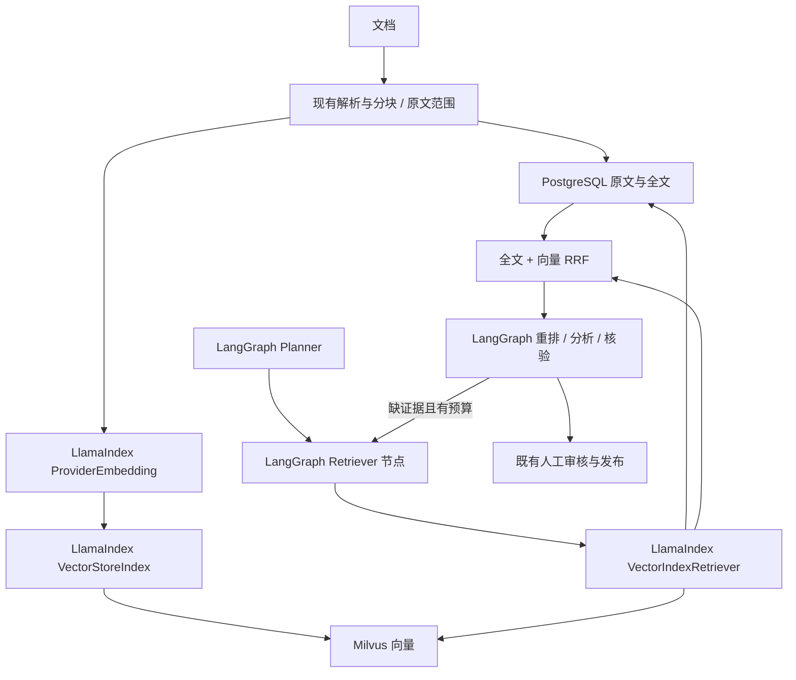

# LlamaIndex 与 LangGraph 组合实现

更新日期：2026-11-12。用户明确要求组合实现。版本：llama-index-core 0.14.25、LangGraph 1.2.17、Milvus/pymilvus 2.4.15。

## 谁负责什么

| 部分 | 实际职责 |
| --- | --- |
| 现有来源解析与分块 | 按类型解析，保留 SourceBlock、章节/页序和原文字符范围，生成既有 Chunk |
| LlamaIndex | Chunk 映射 TextNode；ProviderEmbedding 分批嵌入；VectorStoreIndex 执行索引写入；VectorIndexRetriever 执行向量召回 |
| 项目存储适配器 | RevisionVectorStore 实现 BasePydanticVectorStore，连接现有 Milvus/PostgreSQL，核对归属和写入结果 |
| Milvus | 按索引版本存 chunk_id/embedding，以 HNSW/COSINE 搜索 |
| PostgreSQL | 正文、原文范围、权限、版本、快照与全文索引，保留业务数据权威来源 |
| 混合检索 | PostgreSQL 全文与向量做 RRF，候选交给现有模型重排 |
| LangGraph | 编排规划、检索、重排、分析、核验和有限补检/修订；沿用预算、事件、检查点与既有人审流程 |



## 接入位置与理由

用户要文档知识库 RAG，同时已有多步骤问答流程。LlamaIndex 接数据层，LangGraph 的检索节点通过 ScopedTools 调用它；没有再建立一套问答 Agent 或运行状态。

入口为 `backend/app/knowledge/llama_rag.py`。`embed_chunks` 通过 LlamaIndex BaseEmbedding 的批处理 API 调项目 Provider，每批最多 8 个文本；首批发现维度后固定后续批次，每批检查任务时限。`index_chunks` 把已有向量和 Chunk ID 交给 VectorStoreIndex，持有 SQL 行锁时不会重复调用模型。批次最初为 16，后续分块实机评测发现网关大批次索引重置，已缩到 8；证据见 [分块策略与对比评测](分块策略与对比评测.md)。

查询先经 ProviderEmbedding 生成一次向量，再把 QueryBundle 交给每个索引的 VectorIndexRetriever。多文档快照共享该查询向量；Provider 是 Workflow 时，嵌入继续经过预算预留、重试、失败和用量记录。可重试的 Embedding 故障仍留下 keyword_only 记录；Milvus 读失败不会被当作 Embedding 降级。

## 引用、权限与兼容

TextNode.node_id 就是 Chunk ID，metadata 保留 index_revision_id/source_ranges；这些字段被排除出嵌入输入，继续只嵌入正文。KeepSourceChunks 显式保留已经切好的片段，防止默认二次切块改变原文偏移。

RevisionVectorStore 仅搜索服务端给定的索引 collection；返回 ID 必须在 PostgreSQL 属于该索引，才恢复成带正文的 TextNode。越界 ID 被排除，重复 ID 取最高分，COSINE 降序。适配器拒绝删除不可变索引，框架自身携带的 node_ids 也须先核对 SQL 归属并只允许缩小范围，其他不支持的过滤参数明确拒绝。权限仍在既有业务入口、运行和引用层检查。

Milvus 继续只存原来的 ID/向量。LlamaIndex 临时索引结构和 docstore 不另行落盘，新进程可依据 PostgreSQL/Milvus 建立 Retriever。写入仍按 upsert、flush、主键读回成功后才提交业务索引和 active 切换，失败保留旧启用版本。

框架组合未改变 Milvus schema、索引配置指纹及正文嵌入格式，已有 Milvus 数据可直接查询，**无需仅因接入 LlamaIndex 重算向量**。若其他变更改变了解析/分块或模型配置，仍按原规则显式重建。运行清单新增 rag_framework 和 llama-index-core 版本；旧排队任务的冻结代码/依赖身份变更后，需要新建运行。

只安装 llama-index-core，显式注入项目 Provider，未增加默认模型服务或凭据，没有修改全局 LlamaIndex Settings，也没有让框架另行生成最终答案。当前官方 Milvus 插件要求 pymilvus >=2.6.7，与项目 2.4 服务/客户端不匹配；采用自定义协议适配器保留已验证的 schema/故障边界，未升级 Milvus 或引入 Milvus Lite。

## 验证与重现

新增 `backend/tests/test_llama_rag.py` 6 项测试覆盖：批次/维度发现、时限中断、实际 VectorStoreIndex/VectorIndexRetriever 的 ID 与原文范围、禁止默认模型、越界/重复命中、写入范围/不可变删除，以及 Provider 私有凭据不被序列化。

报告：[llamaindex-storage-check.json](../records/benchmarks/llamaindex-storage-check.json)。重现：

```powershell
uv sync --frozen
.venv\Scripts\python.exe -X utf8 -m pytest -q --tb=short
.venv\Scripts\ruff.exe check backend evaluation scripts fixtures
.venv\Scripts\python.exe -X utf8 scripts\smoke\smoke_milvus.py --output docs/records/benchmarks/llamaindex-storage-check.json
```

实机检查在隔离的临时 PostgreSQL 库和随机 Milvus collections 中运行并清理资源。通过 4096 维旧类型转换/回填、现存数据经 LlamaIndex 查询、新版本经 VectorStoreIndex 写入、全文/范围过滤、失败保留旧版本，以及 **LangGraph → LlamaIndex/Milvus → 重排/分析/核验 → 引用保存 → PostgresSaver 检查点**。组合问答只产生 1 次查询 Embedding。

模型响应和向量为合成夹具，未调用付费模型；不代表独立 Celery/Redis 完整调度、浏览器或真实质量验收。本轮未重启 Milvus，重启边界参考原 Milvus 专项历史报告。SQLite 演示保留 JSON/Python 余弦路径，仅嵌入使用相同 ProviderEmbedding；真实 Retriever/Milvus 路径以上述实机报告为证。

## 代价与面试表述

增加 core 及传递依赖，导入/内存成本增加；项目需维护适配器与上游 API 的兼容性。它提供统一索引和 Retriever 接口，没有证据表明引入框架就提高准确率、速度或降低费用。跨库事务、孤儿 collection 与重启恢复窗口等原有限制继续存在。

可以表述：“我用 LlamaIndex 构建向量索引和 Retriever，用 LangGraph 编排检索、分析、核验和补检；Milvus 管向量，PostgreSQL 管原文、全文和权限。通过自定义存储适配器保留快照和引用边界，嵌入继续经过原有预算和运行记录。”

可能追问：为何没直接使用默认切分和 QueryEngine？回答：项目已有按原文范围的引用、预算、人审和逐结论核验，因而复用索引/召回能力，解析契约和最终答案控制仍由项目负责。

本轮最终全量结果：**179 passed, 4 warnings in 100.64s**（含现有回归、同期输入格式扩展及本轮 6 项新测试）。4 条警告均来自 Alembic 的 path_separator 配置弃用提示；全仓 Ruff、`uv sync --frozen --check` 与 `docker compose config --quiet` 通过。

并行格式调整期间，曾因 XLSX 隐藏工作表的行文本断言与解析结果不匹配出现 1 项失败；格式负责聊天核对实际提取内容并修正断言后，单项及上述最终全量均通过。各轮结果不相加。原演示进程未由本次组合验证停止或重启，实机报告来自隔离的新进程；不能将旧进程视为已加载新代码。
