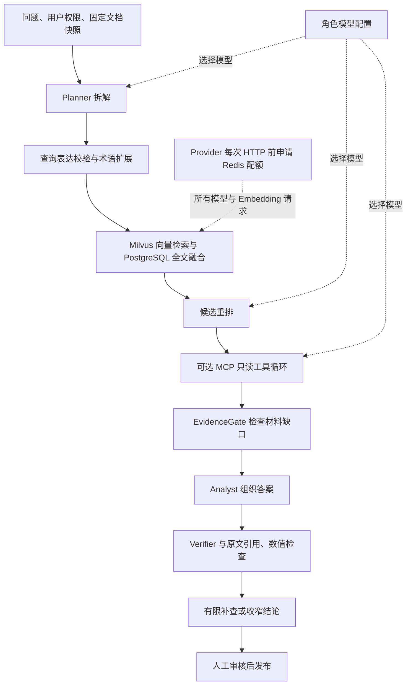

# 查询改写、MCP 编排、角色模型与共享配额

日期：2026-11-13。本项目用于面试准备，本记录同时说明代码行为、选择理由和验证边界。用户授权四项升级，并在服务选择环节明确“你自己弄吧”；因此复用现有模型服务，接入本项目真实运行记录，没有编造第三方日志平台或供应商限额。

## 1. 当前流程与开关



EvidenceGate、既有数值检查和答案人审是相邻能力，不能都算作本轮四项新增成果。工具观察不写入文档索引，也不改变文档快照。

普通配置仍默认使用原聊天模型重排，自动工具循环和共享配额默认关闭。查询改写默认开启，但领域映射为空时不会自动猜测团队术语。测试夹具显式关闭改写以保留旧回归基线，新专项显式开启。

新增启动入口：

```powershell
scripts\start.ps1 -AgentUpgrades
```

它通过 `scripts/agent_profile.py` 给新进程设置配置，执行正常数据库迁移及启动流程；不改真实 `.env`。需要可用的 PostgreSQL、Milvus、Redis，以及已有模型凭据，不能与 `-Demo` 合用。脚本在已有进程记录时拒绝重复启动。本轮没有停止或重启原应用，不能认为当前打开的旧服务已经加载新能力。旧运行仍受其冻结配置约束，验收应创建新运行。

## 2. 查询改写：先保住原问题，再补充团队术语

**问题：**用户问“新人什么时候转正”，资料写“试用期考核”。只靠 Planner 自由生成检索词，容易漏掉规范说法，也可能把对象、数字或否定条件改错。

**为什么放在检索前：**词没送进检索器，后面的重排和分析无法恢复完全没召回的材料。改写只负责增加找资料的入口，不负责证明答案正确。

`backend/app/knowledge/query_rewrite.py` 实现独立模块，规则文件示例为 `docs/examples/query_terms.example.json`。每条规则绑定明确的 `corpus_ids`，包含规范术语及别名；运行创建时只冻结当前知识库的规则，避免不同团队互相污染。

对于不超过 500 字符的问题，每个子问题先保留原问题，再追加“原问题 + 命中的规范术语/别名”；Planner 的表达需通过英文对象/ID、数字、比较符号和部分否定词检查，再锚定原问题。丢失受保护字面量或凭空增加数字的表达记录为拒绝。默认每个子问题最多 5 条表达，各子问题交错执行，并继续受原有每轮最多 15 条检索及运行预算约束。

检索入口原本只接受 500 字符以内的表达。因此对 501–4000 字符的长问题，本模块明确记录 `skipped / original_question_over_search_limit`，保留原 Planner 计划，避免把长问题悄悄换成短目标后声称条件都保住了。原始长问题仍保存在运行输入中；其 Planner 质量不属于该校验能够保证的范围。

`query_rewritten` 事件保存原问题、采用/拒绝的表达和理由；`RetrievalRecord` 保存实际执行的查询和排名。术语规则进入执行清单，之后修改规则文件不会改变已创建运行。

**代价和边界：**多表达增加 Embedding、检索量和等待时间；受保护字面量检查是保守的语法过滤，不能证明中文语义、所有条件或追加内容都正确。接近 500 字符时，超长的追加表达会跳过，原问题保留。真实术语文件应由团队确认；本次只提供示例，没有为生产知识库自动编造映射。

设置 `QUERY_TERMS_FILE` 为本机规则文件路径，规则中的知识库 ID 要用实际 ID。保持 Milvus 向量 + PostgreSQL 全文/RRF，没有替换存储或重跑分块参数选型。

### 实际评测

`evaluation/query_rewrite.py` 用相同问题和相同来源标签，分别对原问题与扩展表达计算融合后 Top5 的来源命中。每种模式均保留失败题并按零召回计入分母。

| 项目 | 已运行结果 | 可以得出的结论 |
| --- | --- | --- |
| 离线词法控制 | 6 道虚构术语题、12 条干扰材料；原表达平均 Recall@5=0.000，扩展表达=1.000；两组各 0 失败 | 证明这组刻意构造的词法错配能被规则补足 |
| 真实 Embedding + PostgreSQL/Milvus | 有 `--live` 入口，独立临时资源；本轮依赖不可用，失败留档 | 不能据离线结果宣称真实 Milvus 召回提升或业务准确率提升 |
| Planner 改写质量 | 未独立标注或盲评 | 不能宣称 Planner 改写始终保持语义 |

报告：`docs/records/benchmarks/query-rewrite-offline-evaluation.json`、`docs/records/benchmarks/query-rewrite-live-evaluation.json`。控制集 `fixtures/query_rewrite/control.json` 明确 `fictional=true / human_reviewed=false`，不是独立人工 gold。离线统计只比较确定性术语扩展，不调用付费模型。真实模式限制最多 100 个独立文本、20000 参考 token，先检查临时存储可用性，再调用 Embedding；不调用聊天模型或重排服务。

## 3. MCP：让工具进入问答，但只执行已授权的读取

**问题：**文档能说明接口设计，却通常不能说明“我刚才那次问答为什么失败”。过去已有 MCP 客户端与写操作审批接口，但问答链路没有真正选择和使用工具结果。

**为什么放在文档检索后、分析前：**ToolRouter 能根据问题及已找到的材料决定是否补查，Analyst 能同时看到文档和外部观察。把工具结果直接作为最终答案，会绕过引用、核验和人审。

新增 `backend/app/agents/workflow_tools.py`，流程是：发现当前用户和知识库被授权的只读工具 → ToolRouter 提出一次调用或返回空 → 服务端再检查权限、配置身份和 JSON Schema → 先保存 invocation 审计 → 执行 → 保存成功回执并生成观察引用 → 如有必要再选择工具。默认最多执行 2 次，拒绝相同参数的重复调用；调用选择本身也消耗原有模型调用预算。

工具目录最多取 4 个服务、12 个工具。外部服务继续使用原 MCP 配置白名单；写工具不进入这条自动链路。原有外部写审批接口保留，但不因问答需要而自动执行写操作。执行前复查当前成员资格、server fingerprint、Schema 和 attempt；凭据不能作为模型参数转发。每个 MCP 会话保留服务配置的超时，内部日志为 10 秒；运行总时限在步骤前后复查，不声称能立刻取消远端已发请求。

### 本次实际接入的工具

`backend/app/integrations/project_logs_mcp.py` 是真实 MCP stdio 服务，工具 `query_run_logs` 读取本项目数据库运行记录。它不需要另起一个对外 HTTP 服务，也不需要用户补充日志平台地址。

- actor、corpus、数据库连接由服务端环境注入，模型只能传 run_id、1–168 小时时间范围和 1–10 条记录上限。
- 只查当前知识库中本人发起的运行，返回状态、错误、限定事件字段及模型调用状态/耗时。
- PostgreSQL 使用只读事务，SQLite 控制测试使用 `query_only`；不返回完整问题、提示词或模型正文。
- 输出经脱敏，明确“记录不证明故障根因；无记录不证明系统无故障”。

这属于真实项目运行日志接入，**没有接入第三方线上业务的日志平台**。自动化检查通过真实 stdio 协议读取临时 SQLite 中实际持久化的失败执行；失败由 FakeProvider 触发，日志回执不是 Mock，但问答决策模型是测试替身。真实模型 ToolRouter 冒烟只验证空工具目录时返回空，没有完成真实模型自主选日志工具的整栈验收。

### 工具引用与文档引用的区别

`EvidenceSpan` 新增 `invocation_id / source_sha256`，文档 `block_id` 允许为空；迁移 `0011` 保留旧引用范围。外部引用必须指向本次运行、同一 owner 的成功调用，且回执哈希和摘录字符范围一致。失败调用不产生可用证据。

API/前端显示 `mcp_observation`、调用 ID、观察时间及保存的回执，不伪造 PDF 页码；观察不写入文档索引。引用这类证据的论点需明确出现“工具记录”或“日志记录”，仍经过语义核验和最终人审。

内部运行日志仅本人及管理员/编辑者可读；普通阅读者即使能看知识库文档，也不能借已发布答案获得私人日志。当前带受限观察的答案详情会受到证据权限检查，可能对无权限成员整体不可读，还没有自动生成一个剔除私人日志的公共答案版本。其他外部工具观察也复查查看者当前的 MCP 授权。数据库管理员仍能改库，哈希校验是篡改检测，不等于不可篡改存储。

## 4. 按角色选择模型：先固定映射，再谈收益

**问题：**所有步骤共用同一聊天模型，不便比较简单规划、工具选择、复杂分析的不同需求；让聊天模型重排也未必适合所有数据。

`backend/app/agents/model_routing.py` 提供统一解析：角色 → 模型名/服务地址/API 类型/凭据环境变量名/可选单价。支持 Planner、Reranker、Analyst、Verifier、ToolRouter、EvidenceGate。未指定的角色回退已有聊天配置。路由进入冻结清单，ModelCall 记录实际角色模型；凭据只在运行时解析，不写进清单。

启用本轮 profile 后：

| 角色 | 配置 | 原因与状态 |
| --- | --- | --- |
| Planner | `qwen3.8-flash`，沿用现有聊天网关 | 作为规划候选，结构化真实请求已通过；未证明质量/成本优于原模型 |
| ToolRouter | `qwen3.8-flash` | 只做有界调用提案；空目录返回空已实测 |
| Reranker | `Qwen/Qwen3-Reranker-0.6B`，沿用现有 Embedding 网关，调用 `/rerank` | 真实两候选排序检查通过 |
| Analyst、Verifier、EvidenceGate | 沿用 `.env` 的 `MODEL` | 不依据模型名称猜测复杂分析质量 |

专用重排响应只允许已给候选的索引，检查重复、越界、非有限/范围外分数、异常条目及用量结构；来源 ID 由服务端映射，不采信服务返回的任意文档 ID。专用接口不是聊天 JSON 输出。复合问题的 API query 使用原问题加去重的 Planner 子问题目标，在一次请求内排序，避免只按未拆分的原问题重排。

真实三次请求记录于 `docs/records/benchmarks/role-model-live-smoke.json`：Planner 约 11.954 秒，输入/输出 token 484/408；ToolRouter 约 8.703 秒，306/174；Reranker 约 2.656 秒，预期相关候选排首位。重排服务没有可用 usage，所以 `usage_known=false`，不能把字段中的占位 0 解释成免费或零 token。

不同角色单价需显式配置；自定义模型没有单价时，不继承原模型价格，成本保持 unknown。这里完成的是**固定角色路由和接口连通性**，没有动态路由、价格核实、重复延迟实验或同题答案质量/成本对照，不能写已经降本或提速。

## 5. Redis 共享配额：在发请求前阻止多个 worker 超额

**问题：**任务容量控制只知道本项目排了多少任务，单进程熔断只知道本进程是否连续失败。四个 worker 各自允许请求时，合计仍可能超过同一个模型账号的额度。

**为什么放在 Provider HTTP 前：**Planner、Embedding、重排和 HTTP 重试都从此处发出。在任务入口只扣一次额度会漏掉一个任务里的多次调用。

`backend/app/integrations/provider_quota.py` 使用 Redis Lua 将“清理过期预留 → 统计 RPM/估算 TPM → 判定 → 写入预留”作为一个原子操作。用 Redis `TIME`，避免各 worker 本地时钟偏差。ZSET 保存请求时间，HASH 保存 token 预留，窗口 60 秒；相同 base URL + API key 共用池，模型/角色不同也共用。不同端点/凭据会分池，不代表自动识别供应商后台所有跨账号或跨端点的额度规则。

每个实际 HTTP 尝试都预留一次；输入采用已有 UTF-8 字节加开销的保守估算，生成请求另加最大输出额度。它不是供应商精确 tokenizer。请求失败或响应丢失不退预留，因为服务可能已经处理并计费；可能少用额度，换来避免过量发送。超过配额立即返回明确错误，不增加隐式等待队列。Redis 不可用时停止发模型请求，不绕过保护；额度拒绝不当作供应商故障增加熔断失败数。

本轮启动 profile 使用 **30 RPM / 200000 估算 TPM**，这是本地应用策略，**供应商真实限额仍未知**。普通设置默认不开启共享配额；开启但未另设时的代码值为 60 RPM / 200000 TPM。独立进程必须使用相同 Redis、namespace 和账号/端点才共享。原供应商熔断仍是进程内状态，本轮没有把熔断迁移到 Redis，也没有实现 Redis 高可用。

### 实际多进程检查

历史记录：Docker Linux 引擎曾在本轮不可用，因此用 WSL Ubuntu 编译 Redis 7.4.2，单独绑定 `127.0.0.1:56480`，关闭快照和 AOF；不是生产 Celery broker。随后 Docker Desktop 恢复，代码修复回归在固定镜像中完成。Windows 客户端实际连接该 Redis，由 4 个 spawn 进程发起 12 次申请，每次估算 100 token；测试额度设为 3 RPM/300 TPM。

结果：**3 放行、9 拒绝、无意外结果**；把随机测试命名空间中的时间戳设为已过期后再次申请成功；测试键剩余 0。该检查没有调用模型 HTTP，也没有等待一整分钟模拟自然窗口。报告 `docs/records/benchmarks/provider-quota-live-check.json`。临时 Redis 在验证后关闭，源代码/编译产物留在 `tmp/provider-quota-runtime`，没有改生产 Redis 数据。

## 6. 代码与验证入口

| 范围 | 关键位置 |
| --- | --- |
| 改写/配置冻结/实际检索记录 | `backend/app/knowledge/query_rewrite.py`、`workflow.py`、`governance.py` |
| 工具选择/真实日志/MCP 客户端 | `backend/app/agents/workflow_tools.py`、`project_logs_mcp.py`、`mcp_client.py` |
| 外部引用/迁移/前端标识 | `backend/app/knowledge/evidence.py`、`models.py`、`backend/migrations/versions/0011_external_evidence.py`、`frontend/src/App.vue`、`runProgress.ts` |
| 角色路由/专用重排 | `backend/app/agents/model_routing.py`、`providers.py` |
| 共享额度 | `backend/app/integrations/provider_quota.py`、`providers.py` |
| 专项回归 | `backend/tests/test_agent_upgrades.py` |
| 接入配置 | `.env.example`、`scripts/agent_profile.py`、`scripts/start.ps1` |

可复现命令：

```powershell
.venv\Scripts\python.exe -X utf8 -m pytest backend/tests/test_agent_upgrades.py -q
.venv\Scripts\python.exe -X utf8 evaluation/query_rewrite.py
.venv\Scripts\python.exe -X utf8 evaluation/query_rewrite.py --live
.venv\Scripts\python.exe -X utf8 scripts/smoke/check_provider_quota.py
.venv\Scripts\python.exe -X utf8 scripts/smoke/smoke_role_models.py
```

最后一个命令会进行真实模型请求并可能计费，不必为了展示文档反复运行。共享额度脚本默认连接本项目 Redis 56379，可用 `--redis-url` 指定隔离实例；其测试命名空间随机且会精确清理。真实检索脚本依赖 PostgreSQL/Milvus，失败与成功均保留报告，不把未执行变成零失败成绩。

最终回归结果见下方收尾记录及 `tmp/agent-upgrade-validation/pytest-final.log`；全部数字按当次工作区记录，不与旧测试数量相加。此次工作区还含同期 EvidenceGate 改动，不将全量结果都归因于本轮四项升级。历史付费分块 benchmark 未重跑，核心分块规则及其 fixtures 未改。

## 7. 面试时可以这样讲

“我把找资料和用工具分开控制：检索前保留原问题并按知识库术语表增加表达，检索后只允许模型从服务端授权的只读工具中提出调用。工具结果有独立回执与引用，不当作团队正式制度。不同角色可以配置模型和专用重排器，每次模型 HTTP 尝试都先向 Redis 原子申请共享额度。模型路由和 Redis 多进程拦截已做实测，术语收益目前只有虚构词法控制结果，真实业务召回和成本改善还要同题评测。”

常见追问：为什么不用模型自由改写？因为语义可能漂移，所以保留原问题、过滤受保护字面量并留下事件，但仍承认语义无法靠正则证明。为什么不用本地计数器？因为多个 worker 会各算各的。为什么失败不退配额？因为响应丢了不代表供应商没执行。为什么日志不能直接当结论？因为状态记录通常只能证明观察到的现象，不能独立证明根因。

## 8. 本轮最终收尾证据

- 新增升级专项：**18 passed, 1 warning in 9.26s**。包括真实 stdio 读取持久日志、当前身份/普通阅读者限制、回执篡改、未知/写工具拒绝、角色路由、专用重排异常响应、长问题明确跳过、配额失败零 HTTP、0011 保留原引用。
- 历史工作区全量曾为 **314 passed, 6 failed, 6 warnings in 78.06s**，六个失败由 Docker Engine 当时不可用造成。Docker Desktop 恢复后重新验证：`test_code_repair.py` **14 passed**，全后端 **430 passed, 6 warnings in 101.84s**；没有改成 Mock 或跳过。真实代码修复质量和独立隐藏验收集仍未评测。
- `npm.cmd run build` 成功，`npm.cmd test` **10 passed**；未做本轮浏览器操作验收。
- 全仓 Ruff、`uv lock --check`、`docker compose config --quiet` 与 `start.ps1` PowerShell AST 解析通过；Docker Desktop 当前使用本机 `desktop-linux` context，Client/Server 均为 29.7.2。
- 真实检索首次尝试因管理连接没有显式连接时限而长时间等待，终止了本次评测自己的 Python 进程；给新评测入口的管理连接补充 5 秒连接时限后重新执行，得到 `OperationalError / e3q8` 的失败报告。没有改原分块 benchmark。当前未取得真实改写检索成绩。
- 临时 Redis 7.4.2 已检查无剩余键并关闭；实际 `.env` SHA-256 仍为 `9e47455bfa42bddeb2df145781e1da850cf3d2ba9358a080e27c0348d6ef9391`。没有记录密钥、初始化 Git、覆盖生产语料或重启原 API/worker。

主要机器报告在 `docs/records/benchmarks/role-model-live-smoke.json`、`provider-quota-live-check.json` 和两个 query-rewrite 报告；全量及专项日志在 `tmp/agent-upgrade-validation/`。源码前备份在 `tmp/agent-upgrade-before-20261113`，不含真实 `.env`；不是 Git 提交或可复现容器镜像。
