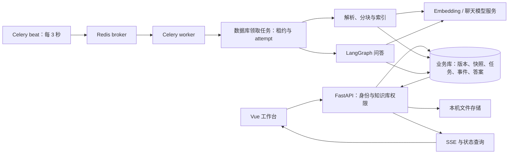

# 团队知识库智能问答系统：项目事实、变更与评测档案

2026-11-16 后续实际接入：新增可选 `ngram_bm25` 运行配置，保持 legacy 默认，词法索引按工作流缓存并绑定快照/容量，配置固定在执行清单。真实 PostgreSQL/Milvus 独立临时资源上的 17 题对照复现 Recall@12 的 10/43→18/43；83 项定向回归和 Ruff 通过，新收费调用 0，临时资源已核实清除。仅为开发题检索覆盖，不是答案准确率/独立人审或默认上线；宽候选重排和指代改写仍待验证。[记录](docs/records/2026-11/中文词法召回实际接入_2026-11-16.md)。

2026-11-16 实验事实补充：同一三本长文本、17 道开发题、43 条证据及相同片段数下，新增实验用中文短语 BM25 与向量融合，Recall@5 由 7/43 到 13/43，Recall@12 由 10/43 到 18/43；5 题改善、2 题退步。只读回放及候选池上限分析已实现，31 项定向回归与 Ruff 通过；产品默认检索尚未替换，没有独立测试集、正式人审或生产效果结论。小窗口/子问句实验的正负结果、费用和原始结果位置见[对照记录](docs/records/2026-11/中文长文本召回改进对照_2026-11-16.md)。此条仅归档项目事实，不修改简历。

2026-11-14 后续：适用条件的 ASCII 标识符边界覆盖点号与连字符连接，修复 `setting A.1` 和 `pre-setting A` 的部分匹配；正常句末标点仍可匹配。修复前新回归 2 项失败，修复后数值校验/门控/工作流三文件 86 项通过、Ruff 通过；未用真实模型或整栈复测，不能据此声称理解任意语义或否定关系。

2026-11-14 补充：数值证据的适用条件匹配增加 ASCII 标识符边界，避免 `setting AB` 被误认为 `setting A`；空格差异仍可匹配。修复前复现错误，相关三文件 75 项和扩充边界用例 5 项通过（两组重叠），Ruff 通过。规则不验证任意语义或否定关系，未用真实模型或整栈复测。

> **用途：供撰写简历、项目介绍和面试材料的 Agent 阅读。** 本项目用于面试准备，既要有实际代码，也要能解释设计原因。本文件记录当前做到了什么、怎样实现、经历过哪些失败和验证，以及哪些结果尚未取得。请以证据等级决定措辞，不把设计目标写成已交付成果。
>
> 核对日期：**2026-11-14**。项目根目录：`F:\项目2`。当前定位：**面向新人上手、制度与技术资料查询的团队知识库问答最简版**。这是本地开发与演示项目，尚无生产上线、实际企业用户或正式效果评测的证明。Docker 阻塞已解除，真实存储/队列的隔离流程、并发边界及浏览器验收见[2026-11-14 记录](docs/隔离联调验收_2026-11-14.md)；模型为确定性替身，未进行本轮付费模型质量评测。

## 1. 简历 Agent 先读这一页

### 1.1 项目一句话介绍

实现一个带知识库成员权限的知识问答原型：上传 PDF、DOCX、Markdown、TXT、CSV/TSV、JSON/JSONL、HTML/HTM 或 XLSX 后按类型解析并异步建立索引，在固定文档版本内混合检索，通过 LangGraph 编排规划、证据重排、分析与核验，输出带原文引用、适用条件和材料缺口的逐条答案，并保留任务、事件和运行轨迹。

### 1.2 已有成果与证据强度

| 内容 | 当前事实 | 可以支持的表述 |
| --- | --- | --- |
| 团队知识库、三级角色、多格式文档、引用问答 | 后端与 Vue 界面已有实现；相关确定性测试通过 | “实现了……的原型/最简版” |
| 多格式类型化入库 | 现已支持 PDF/DOCX/Markdown/TXT/CSV/TSV/JSON/JSONL/HTML/XLSX；CSV 行、JSON 路径、HTML 标题、XLSX 工作表/行保留为引用位置 | “扩展常见团队数据文件解析并复用版本化证据链”；不写任意格式、旧 XLS、OCR、公式计算或在线数据源 |
| PDF 表格结构提取 | PyMuPDF 线条策略识别带边框表格，按表头/数据行生成 SourceBlock，保留页码和每行 bbox；普通文本块中的同一表格文本会被替换，避免重复索引 | 仅称“可检测的有边框表格”；无边框表格、OCR 和公式结构仍不支持，需核对原 PDF |
| 后端回归测试 | 2026-11-13 四项升级收尾全量：**314 passed, 6 failed, 6 warnings in 78.06s**；失败为 Docker 不可用的代码修复用例；含同期 EvidenceGate 改动 | 可以描述通过范围和环境失败，不能写当前全量通过或 314 道问答题 |
| Python 静态检查 | `.venv/Scripts/ruff.exe check backend evaluation scripts fixtures` 通过 | “通过项目 Python 静态检查”；不等于运行期或真实服务验证 |
| MCP、外部写审批与确认记忆 | 用户确认后新增后端接口；18 项专项通过，本机 stdio/HTTP 实际协议测试 | “实现可配置 MCP 客户端、参数绑定审批与未知结果处理、确认后复用的私有记忆”；没有真实第三方接入证据 |
| 问答内 MCP 工具编排 | 受限只读工具循环、真实项目日志 stdio、调用回执独立引用；本地协议/权限/篡改测试通过 | 可以写工具参与完整控制流程；真实模型自主调用日志的整栈仍待验收，不代表第三方生产日志接入 |
| 可验证查询改写 | 分知识库术语表、原表达保留、字面量过滤、运行冻结及事件记录；6 道虚构词法控制通过 | 可写模块与对照入口；0→1 是刻意构造的离线控制召回，不是业务或 Milvus 指标 |
| 角色模型与专用重排 | 固定角色配置，qwen3.8-flash 与 Qwen/Qwen3-Reranker-0.6B 三次真实接口冒烟通过 | 可写角色路由和专用重排接入；没有同题质量、延迟或成本改善证据 |
| 跨 worker 模型配额 | 真实 Redis 7.4.2，4 进程/12 申请，3 放行/9 拒绝，过期恢复及测试键清理通过 | 可写 Redis Lua 原子配额及跨进程验证；供应商真实额度未知，不是集群高可用验收 |
| 隔离代码修复任务 | 固定 Git worktree、补丁范围保护、本机 Docker pytest、人类最终审核；样例仓库的 Docker 控制测试通过 | “实现本机代码修复任务流”；不能写通用沙箱、自动生成基准测试或真实模型修复率 |
| 问答答案人工审核 | 已实现 `review_pending` 门禁、成员角色审核队列、拒绝理由修订 replay、答案 SHA 绑定和接受后案例记录；新增接口集成测试 | “答案需管理员/编辑者审核后向成员发布”；自动评测须在隔离配置关闭门禁。正式业务效果与长期审核吞吐尚无测量 |
| 前端构建 | 本次 `npm.cmd run build`：Vue 类型检查及 Vite 生产构建成功 | “完成 Vue 3 + TypeScript 工作台并通过构建” |
| 真实聊天模型、Embedding | 有历史连通性报告与两条教学材料运行记录 | “完成过真实模型集成检查”；须说明材料与存储环境 |
| PostgreSQL / Milvus | Milvus 存向量、HNSW/COSINE；PostgreSQL 保留正文、业务与原生全文检索；0009 + 可重跑回填工具 | “实现 Milvus 与 PostgreSQL 分工的混合检索”；实机证据与剩余边界见 [Milvus迁移与验证](docs/Milvus迁移与验证.md) |
| Celery / Redis | Celery 代码、beat、Redis 配置和本地启动脚本已写；任务适配测试通过 | “接入 Celery 任务执行层”；不能写已完成 Redis 集群或实际分布式验收 |
| 正式效果评测 | 有格式、运行器、汇总器与评测入口；无冻结真实题集和成绩 | “搭建评测框架/预留评测入口” |
| 防幻觉增强与人工评测 | 数值/单位/有限算式及逐子问题缺口检查、Verifier 证据与理由、12 道未审虚构开发题、SHA 绑定人工标注导入 | “增加确定性检查与独立人工评测入口”；没有真实质量提升或校准置信度成绩 |
| 真实业务 Recall@5、引用语义支持率、业务提效 | **尚无正式业务结果**；已有虚构分块实机对比与术语词法控制，证据需分别注明 | 不将控制集数字写成业务准确率或业务提效 |

**最新全量是 314 通过、6 失败，不能写全绿。6 条 warning 为 Alembic path_separator 弃用提示。总数含多个同期部分，不是本轮新增数量；本地控制测试、真实模型三次接口冒烟、真实 Redis 多进程检查与正式业务效果各自独立。构建不是浏览器端到端，历史真实存储证据也不代表当前 Docker 可用。**

### 1.3 阅读与取证规则

快速写简历先读第 1 节的完成状态、第 21–23 节的亮点与措辞；核对评测读第 17–20 节；准备技术追问读第 5–15 节；追溯改动读第 16 节，源码位置见第 25 节。所有简历要点均应能对应到后文证据。

1. 本文件优先描述当前代码；README、`docs/scope.md`、`docs/architecture.md` 已按第五部分记录同步团队范围。较早的变更记录可能保留当时的旧范围描述，需结合后续日期的修订判断。
2. “已实现”指存在对应代码；“自动测试通过”指特定可控场景得到验证；“实际联调通过”需要真实依赖和独立进程证据；“正式评测完成”需要冻结题集及人工标准。四者不能互相替代。
3. 当前目录没有 Git 仓库元数据。变更历史依据现存源码、文档、运行产物和对话中已确认的记录重建，不声称是完整的逐提交 diff。无法恢复的修改日期、尝试次数和旧代码细节不补写。
4. 不读取或转录 `.env` 中的密钥，也不把本地管理员密码写进简历材料。模型名称可以引用已保存的连通性报告，但它不是模型训练成果。
5. 个人职责、项目起止月份和实际使用人数没有充分证据，写简历前需由本人确认，不自动写“独立负责全部研发”或“服务某企业”。

## 2. 项目背景与范围演进

### 2.1 解决的具体问题

团队资料分散在制度、操作手册和技术方案中。新人遇到问题时需要找文件、核对版本、定位段落，还容易把过期规则或不同条件下的结论混用。项目把“找到材料—组织回答—回到原文核对”连起来，并把成员权限和文档更新纳入问答链路。

它主要用于查询已有文档中的规则、流程、技术事实及跨文档差异。遇到缺少证据的部分，系统保存缺口；不能因为模型知道常识就补成团队制度。

### 2.2 从论文问答到团队知识库

| 阶段 | 主要内容 | 当前保留/变化 |
| --- | --- | --- |
| 早期论文问答 | 本机单用户、文本型 PDF、论文版本、快照、混合检索、Planner/Analyst/Verifier、引用、持久数据库 worker | 证据链与任务可靠性成为后续基础 |
| 可演示工作台 | Vue 3 + TypeScript，暖白/青绿的材料、问答、证据三栏；虚构 A/B/C 教学 PDF；真实模型检查 | 颜色和三栏结构沿用 |
| 按新版简历改为团队知识库 | 用户明确确认替换范围：多用户、知识库成员、三级 RBAC、目录标签、文档增删改、多格式类型化解析、Celery、重排、运行追踪与评测入口 | 当前支持 PDF/DOCX/Markdown/TXT/CSV/TSV/JSON/JSONL/HTML/XLSX；不是任意二进制或在线数据源 |
| 面试讲解约定 | 新增共享说明，要求修改时解释问题、原因、位置、流程、代价、验证和面试讲法 | 属于持续开发约定，不是业务功能 |
| 本次项目归档 | 核对源码和现存评测，重新运行测试与构建，整理本档案 | 本次没有增加新的业务机制 |

原参考资料为《第二项目_论文知识库问答Agent_完整详解与实现步骤.md》，新版目标来自《孟庆睿_软件开发工程师_简历_项目完成版.html》的“团队知识库智能问答系统”。参考文档中的示例、命令和计划不自动代表已经实现。

### 2.3 命名兼容情况

业务名称已改为团队知识库，但数据库和接口保留 `Corpus`、`Paper`、`PaperVersion`、`/papers` 等早期命名，避免一次性重命名破坏版本、引用和现有数据。这里的 `Paper` 在新版代表一般文档。

FastAPI 对外版本是 `0.2.0`；Python 包、前端包仍有 `paper-qa-*` 和 `0.1.0` 历史标记。不能仅凭包名认为新版只支持论文，也不应声称全部命名和旧文档已整理完毕。

## 3. 当前功能清单

| 功能域 | 已有实现 | 边界与完成状态 |
| --- | --- | --- |
| 账号 | 登录、当前用户、退出、会话到期；本机管理员初始化 | 无公开注册、找回密码或 SSO |
| 知识库 | 创建、列出本人有权访问的知识库、后端重命名接口 | 前端有创建/选择，未提供完整的库生命周期管理 |
| 共享 | 添加新账号或已有账号、更新角色、移除成员、保护创建者 | 按知识库授权，无文档级/段落级 ACL |
| 目录标签 | 文档标题、目录字符串、标签编辑，前端筛选/搜索 | 目录是字段，不是独立目录树实体；不是完整文件系统 |
| 文档管理 | 上传、元数据修改、明确上传同文档新版本、软删除、历史版本、失败重试、后端重建索引接口 | 修改正文通过上传新文件；无富文本在线编辑器 |
| 入库 | PDF、DOCX、UTF-8 Markdown，解析、清洗、分块、Embedding、索引状态 | 不支持旧 `.doc`、OCR 和可靠公式/复杂表格恢复 |
| 检索 | PostgreSQL 全文与 Milvus 双路、快照白名单、RRF、聊天模型重排、相关原文块选择 | 无专用 Cross-Encoder；HNSW 小规模存储检查通过，无 ANN 规模性能验收 |
| 问答 | 问题拆解、证据分析、逐论点核验、有限补检/修订、澄清/部分回答/材料不足 | 同一聊天模型承担多个节点；不是训练多个专属模型 |
| 追问 | 沿用父问题快照，前文仅用于指代，历史问题链最多读取 4 条 | 文档变更后需重新开始问题；历史回答不充当事实证据 |
| 引用 | 服务端原文范围、版本、哈希、页序/章节；原文件入口 | PDF 跳页，无文字高亮；非 PDF 按章节、工作表/行号或 JSON 字段路径显示并可下载原文，不虚构打印页码 |
| 运行管理 | 持久任务、幂等键、租约、attempt、取消、私有历史、冻结清单、只读记录与重新执行 | 恢复从新 attempt 开始但保留累计预算；重跑是新付费运行，不承诺外部调用恰好一次 |
| 可观测性 | request_id、节点耗时、调用开始/结束、HTTP 尝试、未知用量与预留、检索和来源 | request_id 直接使用 run ID；未接分布式 tracing 或供应商账单服务 |
| 反馈 | 保留原话、用户分类、答案哈希、幂等键；本人可回看 | 不自动成为事实或正式回归，不是人工审批 |
| 评测 | 三种配置、模板、认证批量运行、全题分母/失败/未知用量/P95 汇总 | 登录已接入运行器；真实题集、Recall@5 与正式成绩尚缺 |

## 4. 技术栈与整体结构

### 4.1 技术栈及真实用途

| 技术 | 用途与使用深度 |
| --- | --- |
| Python 3.11–3.13、uv | 后端与评测脚本；`uv.lock` 固定依赖 |
| FastAPI、Pydantic | API、依赖注入、上传、会话身份、严格结构校验、SSE |
| SQLAlchemy 2、Alembic、psycopg | 业务持久化、事务/行锁、迁移、PostgreSQL 连接 |
| PostgreSQL 17、Milvus 2.4.15 | PostgreSQL 管业务和全文，Milvus 管 HNSW/COSINE；pymilvus 客户端接入，Docker Standalone 单机运行 |
| Redis 7、Celery 5 | Redis 作为默认 broker；worker/beat 触发数据库持久任务处理。没有实现 Redis 缓存命中优化 |
| LangGraph 1、PostgresSaver | 有状态节点、条件路由、有限循环；正式 PostgreSQL 路径配置检查点 |
| PyMuPDF、python-docx | PDF 原始文字块/坐标、DOCX 段落/标题/表格文字；Markdown 自行解析 |
| httpx | 后端兼容聊天/向量 HTTP 接口；不是浏览器直接调用模型 |
| Vue 3.5、TypeScript 5.9、Vite 7 | 单文件工作台、响应式状态、类型检查和构建；未使用 React、Pinia 或复杂前端路由 |
| lucide-vue-next | 界面图标 |
| pytest、Ruff、ReportLab | 控制逻辑测试、静态检查、生成明确标记为虚构的教学 PDF |

### 4.2 服务结构



这是**模块化单体加独立任务执行进程**，不是微服务集群。模型服务是外部依赖；API、任务逻辑、检索与权限属于同一项目。文件保存在本机目录，没有对象存储接入。

## 5. 数据模型与证据链

### 5.1 实体拆分

| 实体/表 | 保存什么 | 为什么分开 |
| --- | --- | --- |
| Corpus | 知识库名称、创建者 | 提供共享与文档归属边界 |
| User / LoginSession / Membership | 账号、会话哈希/到期时间、库成员角色 | 区分“你是谁”与“你能访问哪个库” |
| Paper | 文档逻辑身份、标题、目录、标签、软删除标记 | 同一文档可以有多个文件版本 |
| PaperVersion | 文件 SHA-256、存储键、文件名、大小、状态、启用标记、attempt/租约 | 原文件变化形成新版本，历史引用不被覆盖 |
| ParseRevision | 文档版本、解析配置与状态 | 解析器升级与文件更新是不同变化 |
| SourceBlock | 原始文字、块序、PDF 页序/bbox/页标签、章节 | 保留可核对的原文，不能让清洗后的索引文本替代它 |
| IndexRevision | 解析版本、分块/Embedding 配置、模型与维度、状态 | 更换向量配置时建立新索引 |
| Chunk | 清洗文本、原文范围映射、全文字段；生产向量保存在 Milvus | JSON embedding 仅为旧库回填过渡/SQLite 测试使用，生产入库不写该向量 |
| Snapshot | 一次选定的文档/解析/索引版本清单 | 固定问答和追问所使用的材料 |
| QuestionRun | 问题、模式、父问题、用户、幂等键、状态、配置、图状态、attempt | 一次执行及其恢复边界 |
| RunEvent | 每次运行递增 seq、attempt、事件与时间 | 刷新或重连可以补读进度 |
| RetrievalRecord | 轮次、子问题、查询、融合排名及命中文档 | 排查“没有找到”还是“选错证据” |
| EvidenceSpan | 运行、原始块、起止字符、逐字摘录 | 后端生成可验证的引用身份 |
| AnswerRevision / AnswerClaim | 发布答案状态、缺口、开销；有序原子论点、条件、是否经过模型核验 | 便于逐论点核查，而非只存一段自由文本 |
| ClaimEvidence | 论点到证据及 supports/qualifies/contradicts/background 关系 | 同一证据可支持、限定或反驳不同论点 |
| ModelCall | 角色、请求/响应、状态、usage 已知位、Token/预留、Provider ID、耗时 | 发送前落盘；缺 usage 保留未知，各 attempt/HTTP 重试累计，不保存密钥 |
| ReviewRecord | 原话、提交者、用户分类、答案哈希和幂等键 | 与事实来源隔离；哈希是来源身份，不代表人工批准 |

### 5.2 一条结论如何追溯

```text
AnswerClaim → ClaimEvidence → EvidenceSpan
    → SourceBlock → ParseRevision → PaperVersion → 原文件 SHA-256
QuestionRun → Snapshot.manifest → 指定的文档/解析/索引版本
```

因此，“引用能够打开”与“引用语义支持论点”是两层问题：程序可验证来源和字符一致性，模型 Verifier 负责尝试核验语义，但仍可能批准无关或错误论点，需另做人审。

## 6. 身份、共享和三级 RBAC

### 6.1 权限矩阵

| 操作 | 阅读者 reader | 编辑者 editor | 管理员 admin |
| --- | --- | --- | --- |
| 查看库内文档、原文件、创建快照与问答 | 是 | 是 | 是 |
| 上传/更新/编辑元数据/移除文档/重试入库 | 否 | 是 | 是 |
| 列出与管理成员、重命名知识库 | 否 | 否 | 是 |
| 查看其他人的私人问答历史 | 否 | 否 | 否 |

创建者隐式拥有管理员角色，不能被移除或降级。任一登录用户可以创建自己的知识库，并成为该库管理员；不是只有初始化的 admin 账号能创建库。

主要输入约束：知识库名 1–160 字符，文档标题最多 500、目录最多 160、标签最多 12 个且各 1–40 字符；快照选择 1–100 个版本，问题为 2–4000 字符。账号名最多 80、密码 8–128 字符。这些是最简版参数边界，不代表压测得到的容量。

### 6.2 后端检查的位置与理由

前端依据角色呈现操作按钮；`access.require_role` 才是实际权限边界。库列表过滤成员关系，文档和快照按库检查，运行/答案/引用额外检查发起用户，问答执行与发布通过 `check_attempt` 再检查当前成员资格和版本可用性。

原因是上传与问答异步执行：请求入队时有权，不代表出队或发布时仍有权。移除成员时会取消其该库中排队/运行的问答，SSE 读取循环也重新检查运行访问权限。成员权限按库统一生效，不存在段落级 ACL 或目录角色继承。

### 6.3 登录与会话细节

- 密码使用随机盐和 `hashlib.scrypt`：`n=16384, r=8, p=1`；比较使用 `hmac.compare_digest`。
- 登录生成随机不透明令牌，数据库只存令牌 SHA-256 和过期时间；默认会话 24 小时。这不是 JWT。
- 浏览器使用 HttpOnly、SameSite=strict 的 Cookie，后端也接受 Bearer 令牌；没有把模型密钥交给浏览器。
- 添加已有账号不会重置其密码；新账号需要至少 8 位密码。用户名为字母、数字、下划线、点和短横线。
- 管理员初始化保留 `local-user` 身份，以接续旧教学库；随机初始密码只写本机 `data/admin-login.txt`，本档案不包含密码。
- 当前是本机访问配置，未完成公网 HTTPS、限流、密码恢复及企业身份接入，不能表述成完整企业认证平台。

## 7. 文档上传、解析与分块

### 7.1 上传与原文件保存

支持 `.pdf`、`.docx`、`.md`、`.markdown`、`.txt`、`.csv`、`.tsv`、`.json`、`.jsonl`、`.html`、`.htm`、`.xlsx`；默认上传上限 **40 MB**，分批读取并检查大小。文本类要求 UTF-8 且拒绝 NUL；PDF 检查文件头，DOCX/XLSX 检查 ZIP 特征后由各自解析器验证。旧 `.xls` 和无类型解析器的二进制不接受。

上传文件名提取 basename，不把客户端路径作为存储路径。使用 SHA-256 加后缀作为存储键，临时文件写完后用 `os.replace` 替换；同一逻辑文档内重复内容返回 409。相同标题不会自动合并文档，更新必须明确传 `paper_id`。

接口保存文件和 `uploaded` 状态后返回 **202**，解析与模型调用由后台处理。这里实现的是内容寻址存储和版本去重，不是全局语义去重。

### 7.2 各格式实际保留的信息

| 格式 | 解析方式 | 引用定位与限制 |
| --- | --- | --- |
| PDF | PyMuPDF 文本块保留原始文本、内容流顺序、bbox、0 起始 page_index、印刷页标签；线条策略可识别的表格改为带列名的数据行块并保留行 bbox | 1–1000 页；拒绝加密/无足够文字；字少的页给 warnings；不保证双栏阅读顺序、无边框表格、扫描件 OCR 和公式结构 |
| DOCX | python-docx 按文档内部顺序读取段落与表格，Heading 更新章节；表格序列化为带分隔符的文字 | 无固定打印页码；按章节/摘录核对；解压内容上限 80 MB；不支持旧 `.doc` |
| Markdown | 按标题和空行组织块，跟踪围栏代码状态 | UTF-8/UTF-8 BOM；标题变为章节；非完整 Markdown AST/语义解析器 |
| TXT | 按空行切分段落 | UTF-8/UTF-8 BOM；无原生页码，按章节摘录 |
| CSV/TSV | 标准库 CSV reader；第一条非空记录作为表头，行值保存列名和值 | UTF-8；最多 100,000 条记录、1,000 列；引用定位到源行号；未识别编码不自动猜测 |
| JSON | 递归遍历对象/数组，只为标量叶子建立块 | UTF-8；最多 100,000 个 JSON 节点、最大深度 64；引用定位到字段路径 |
| JSONL | 逐行解析，再按标量字段建块 | UTF-8；保留行号与字段路径，格式错误报告行号 |
| HTML/HTM | 标准库 HTMLParser 提取可见文本、标题、表格单元和图片 alt | 跳过 script/style/noscript/svg、hidden/aria-hidden 与常见内联隐藏样式；不运行脚本，不执行 CSS/JS 或获取外链资源 |
| XLSX | openpyxl read-only 读取工作表和值，第一条非空行作为表头 | 最多 100 个工作表、每表 100,000 行/1,000 列、总 2,000,000 单元格、ZIP 解压 80 MB；公式索引为公式文本，不计算；隐藏工作表也纳入 |

所有非 PDF 格式的 `page_count` 为 null。兼容响应中仍可能带通用 `pdf_page_*` 字段，**必须以 `location_kind=section` 和 `location_label` 为准，不能将占位字段当成真实页码**。

### 7.3 分块与原文映射

- 检索块按**字符数**组织，目标上限约 **3200 字符**，不是 3200 Token。
- 单个原文块过长时以 **2200 字符**分段；跨页或跨章节先结束当前 Chunk。
- 同页/同章节分块时，末块长度小于 800 字符可作为下一块重叠；不是固定百分比重叠。
- 清洗合并空白、修复英文跨行连字符，**不覆盖 SourceBlock 原文**。
- 页顶/页底重复文字出现至少 3 次时，排除出检索表示，原始来源仍保留。无 bbox 的 DOCX/MD 不走 PDF 边缘坐标判断。
- 每个 Chunk 保存 `block_id + char_start + char_end` 范围，可从检索文本回到原文。
- Embedding 每批最多 16 个 Chunk，校验服务返回条数、索引、维度、非零和有限数值，按 index 恢复输入顺序。

解析配置为 `multiformat-v2-pymupdf-*`；分块配置在 2026-11-12 第二部分改进中从 v2 升为 `section-page-3200chars-overlap-block-v3`，修正页边重复文本误删正文的问题，详见第 29 节。索引配置指纹还绑定 Embedding 地址、模型名、配置维度和手动 `revision`，配置改变后不能把旧向量直接混查。旧教学索引未自动重建。

## 8. 文档更新、软删除和不可变快照

### 8.1 更新先构建、成功后切换

1. 新文件创建新 PaperVersion，初始 `is_active=false`。
2. 验证文件哈希，解析并建立索引；解析块 ID 可重复确定，重试不重复写同一解析和索引。
3. 在成功事务中锁定版本和逻辑文档，确定最新 ready 版本。
4. 最新成功版本启用，其他版本停用；较早任务迟到完成时，不应覆盖较新的成功版本。
5. 新版失败，旧版继续可查询；后台状态单列为 failed。

这样做是因为“文件上传成功”不等于“新知识已能检索”。该设计保留历史空间开销；旧文件和旧索引不会因更新自动清空。串行成功更新和失败保留旧版有测试；真实 PostgreSQL 并发切换仍需专项联调。

### 8.2 软删除的含义

移除文档设置 `Paper.deleted=true`，不立即物理删除原文件、历史索引和引用。新列表和新问答不能使用该文档；仍有知识库权限的原问答发起人可以回看历史引用。不能描述为“彻底删除全部数据”或“删除后所有历史引用不可见”。

### 8.3 快照固定了什么

快照清单包含文档逻辑 ID、当时标题、文件版本 ID、SHA-256、解析 ID、索引 ID、Embedding 模型和维度。创建时只接收当前库 ready、启用、未删除的版本，并去重版本列表。

问答过程中使用快照内索引白名单；不能由模型传入 owner_id 或扩大库范围。引用标题从快照读取，之后修改文档标题不会改写历史答案。

**当前取舍：**快照记录不可变，但新问答及执行中的问答也要求其中版本仍为当前可用版本。文档被更新、重建索引中或删除后，旧快照不能继续开始新问答，追问/回放也可能返回 409，需重选文档。历史答案可保留；“记录可复现”不代表任意旧快照始终允许再次运行。

## 9. 检索、RRF 与 Reranker

### 9.1 双路检索

全文先限制 `Chunk.index_revision_id` 为快照白名单；向量仅查询白名单索引的独立 Milvus collection，返回 ID 再核对其在 PostgreSQL 中的索引归属，各路最多取 30 个候选。

- PostgreSQL 全文：`simple` 配置，`tsvector`、`plainto_tsquery`、`ts_rank_cd`，词项以 OR 组合，并辅以实体子串匹配；全文字段有 GIN 索引。
- 向量：Milvus HNSW/COSINE，余弦分数降序；每索引独立 collection。已实现不等于已测大规模性能，不写“百万级 ANN 加速”。
- 查询词提取最多 24 项；中文没有高质量分词组件，跨语言语义效果依赖模型，Planner 可给出保留实体的英文查询。
- SQLite 测试/演示路径用词频和 Python 余弦计算代替 PostgreSQL 算子，用于控制场景验证，不能据此证明正式检索性能。

**全文检索不是 BM25。** 当前向量后端已迁为 Milvus；未引入 Elasticsearch 或 Redis 向量检索。

### 9.2 RRF 融合

按 Chunk ID 去重，使用 `k=60`：

```text
score(chunk) = Σ 1 / (60 + 该 chunk 在某一路中的排名)
```

同一路重复出现同一 ID 不重复加分。默认返回融合后的前 12 项，单次工具参数允许 1–30 项。融合保留各路排名，便于解释结果来源。

选择 RRF 的原因是两路原始分数尺度不同，名次可以直接融合；代价是无法自行理解段落是否真的回答问题。**RRF 分数不是答案置信度。**

### 9.3 跨查询收集与重排

多个子问题/查询的候选按 Chunk 聚合分数，按文档交错挑选，候选池最多 24 项，减少单篇文档占满上下文。非 baseline 模式调用聊天模型 Reranker，让它给候选 0–1 相关性分数并选择 `relevant_block_ids`。

程序验证 Chunk ID 存在且不重复、来源块确实属于该候选。只有正分且有相关来源块的项进入后续选择。重排优先选具体规则、步骤、数字和条件，避免标题、免责声明占用证据位置。

最终优先加入本轮相关原文，再补已有来源；每篇最多 16 个证据范围、全局最多 32 个，总摘录受默认 28000 字符预算约束。补检允许重新考虑以前出现过的候选，防止“见过一次就永不再用”。

这是**结构化聊天模型重排与块级选择**，不是专门训练/部署的 rerank 模型。每轮多一次聊天调用，有延迟和费用；真实模型修复效果尚未重新量化。

## 10. LangGraph 问答与受控循环

### 10.1 节点职责和调用关系

```text
Planner → Retriever（内部可调用 Reranker）→ Analyst → Verifier → route
    │                                                       ├→ Retriever：针对缺口补检
    └→ publish：需要澄清                                     ├→ Analyst：有限修订
                                                            └→ publish → END
```

| 节点 | 实际负责什么 | 程序控制 |
| --- | --- | --- |
| Planner | 解析对象/指标/条件，生成最多 5 个子问题、每题最多 3 条查询；指代不明时请求澄清 | 校验结构、非空计划、子问题 ID 不重复；不把材料缺证当作提问歧义 |
| Retriever | 按快照双路检索、候选融合、文档平衡、调用 Reranker、建立 EvidenceSpan | 查询去重、单轮最多 15 条待执行查询、检查时间与权限 |
| Reranker | 选择与子问题相关的候选和原文块 | 不是独立图节点；结构和候选 ID 校验 |
| Analyst | 形成最多 20 条原子论点、条件、证据关系、缺口和冲突标记 | 无 supports 的事实论点不能通过确定性检查；无独立自由正文 |
| Verifier | 检查支持关系、单位/数值、过度推广、比较条件和缺证，给出最多 3 条补检查询 | 只接收已有 claim ID；有未解决问题的论点被剔除，未明确批准也不能发布 |
| route | 决定补检、修订或结束，并持久化计数/停止原因 | 循环决定和预算由服务端控制 |
| publish | 重查引用和执行资格，保存唯一已发布答案、论点和证据关系 | 不在发布后再用模型自由润色，避免产生未经检查的新结论 |

“多 Agent”指职责分离、共享状态、条件路由的图节点，通常复用同一个聊天模型服务。检索工具由 Python 按计划执行，不是让模型自由执行任意工具或 shell；不能把本项目写成已经实现通用 Function Calling 平台。

### 10.2 结构化与提示词约束

Pydantic 结构设置 `extra=forbid`，约束字段、长度、枚举和条数；模型返回非合法结构时作为技术错误，不发布随意文本。提示词要求资料和历史消息中的指令无执行权限，仅分析给定来源。后端也通过固定工具和快照做范围控制，但没有独立的提示词注入安全基准，不能声称已完全防注入。

历史问题只用于指代，用户反馈和历史答案不转化为证据。不同实验条件分开表述，不能把架构文字当作速度/显存测量。若出现计算，要求保留原值、单位和公式；没有独立符号数学证明器。

### 10.3 默认预算及停止条件

| 限制 | 默认值 | 解释 |
| --- | --- | --- |
| 检索轮数 | 2 | 首轮加最多一轮补检，不是无限自主搜索 |
| 生成修订轮数 | 1 | 有被核验指出问题的论点时有限重写 |
| 聊天模型调用 | 8 | 包含 Planner、Reranker、Analyst、Verifier；不含 Embedding 次数 |
| 运行时间 | 240 秒 | 节点/查询间检查；历史 smoke 曾单独设置 300 秒 |
| 摘录上下文 | 28000 字符 | 限制入模证据体量，不等于总提示词 Token |
| 单次模型 HTTP 超时 | 45 秒 | 运行总预算外的请求级超时 |
| LangGraph recursion_limit | 40 | 图执行附加边界，不等于允许 40 轮补检 |

补检前为“重排+分析+核验”预留 3 次调用，修订前预留 2 次。无新证据、达到轮数或预算时结束。预算耗尽保留已检查的部分并显示缺口；网络超时等技术异常则是 failed。

这些机制是**单次运行的预算与终止控制**。Provider 边界另有进程内熔断；用户确认后另有外部写操作审批见第 32 节，问答答案人工审核的后续实现见第 34 节。

### 10.4 三种可比较配置

| 模式 | 聊天角色 | 共同保证 |
| --- | --- | --- |
| baseline_rag | 直接用原问题检索，Analyst 一次生成；跳过聊天 Planner/Reranker/Verifier | 同一范围与引用定位检查，`semantic_verified=false` |
| full_agent | Planner、Reranker、Analyst、Verifier，加有限补检/修订 | 仅发布明确批准且未被确定性检查剔除的论点 |
| without_verifier | Planner、Reranker、Analyst，跳过语义核验与反馈循环 | 仍检查来源、字符范围和 supports 关系，`semantic_verified=false` |

这三种是**问答流程对照/消融**。它们不是“纯全文、纯向量、混合检索”三组检索实验，后者尚未形成可报告结果。

## 11. 引用校验、答案状态与不可覆盖发布

### 11.1 确定性引用校验

EvidenceSpan 的 ID、页序和版本由后端建立，模型只能引用已提供的 ID。发布前至少检查：

1. EvidenceSpan 属于当前 run，来源块属于快照内解析版本。
2. 起止范围为整数，满足 `0 <= start < end <= len(raw_text)`。
3. `SourceBlock.text[start:end] == quote`，逐字一致。
4. 每个事实论点至少有一条 supports，背景/限定不能代替支持。
5. 发布时再检查权限、版本、运行状态、attempt 与取消标记。

防幻觉增强后另加数值原文绑定、有限单位/算式检查和逐子问题去向；Verifier 要给逐论点证据、理由与确定/不确定判定。发布前按最终保留论点重新产生缺口，具体实现与证据见文末“防幻觉增强”记录及 [实施说明](docs/防幻觉增强与开发评测.md)。这仍不是任意语义事实的程序证明。

字符范围是 **Python Unicode 字符下标，左闭右开**；测试包含 emoji，不能误当字节下标或 JS UTF-16 下标。PDF 页面 index 从 0 开始，对外页号是 index+1，印刷页码标签另存。

### 11.2 技术状态与证据状态分开

| 层次 | 状态 | 含义 |
| --- | --- | --- |
| 执行 | queued / running / completed / failed / cancelled | 任务技术上发生了什么 |
| 答案 | supported | 有可发布论点且没有已记录缺口 |
| 答案 | partial | 保留可回答部分，并显示缺口 |
| 答案 | conflicted | 分析标记有条件可比的冲突 |
| 答案 | insufficient | 当前材料与本次检索未得到足够可发布论点 |
| 答案 | needs_clarification | 问题指代/对象需要用户补充 |

`completed` 不代表答案正确；`semantic_verified=true` 只代表经过项目内模型核验，不代表独立人工验收。检索漏掉已有证据也可能返回 insufficient/partial，这属于质量问题，不能包装成正确拒答。

### 11.3 发布与反馈

每个 run 仅发布 revision=1，数据库唯一约束防止重复答案。修改或 `POST .../replay` 创建新运行，原始答案、检索和模型记录保留。新运行按当前配置重新执行原问题/模式/快照，保留原 parent_run_id 并冻结最多四条前问；`replay_of` 纳入清单哈希和幂等检查。重跑会再次调用模型，不保证同一输出；`GET .../recording` 只读既有记录，不调用模型或补造缺失内容。

反馈写 ReviewRecord，保存原话、用户选定类别、答案 SHA-256 和可选幂等键；原因不明确时返回澄清选项，提供本人记录读取。既不覆盖已发布论点，也不自动成为下一次问答事实或已验证回归。该节记录答案审核门禁接入前的反馈行为；当前答案接受/拒绝另见第 34 节，外部写操作另有第 32 节的本人审批流程。

## 12. 异步任务、幂等、恢复和取消

### 12.1 Celery 与数据库任务怎样配合

API 先写业务任务；beat 每 3 秒发送 `knowledge.execute_next`，Celery worker 从数据库领取一个问答或入库任务，复用 `process_job`。Redis 只是默认消息 broker，业务真相在数据库；设置 JSON 序列化、不保存 Celery 结果、prefetch=1、晚确认及 worker lost 拒绝消息。

当前领取顺序优先问答，再处理文档。Windows 使用 solo pool；没有完成多 worker 压测、公平性或队列积压评估，不能声称已验证高吞吐调度。

保留旧 `worker.py` 数据库轮询入口供诊断/兼容，新默认启动脚本采用 Celery worker+beat。这不是同一业务被要求由两套 worker 同时执行。

### 12.2 租约与 attempt

- PostgreSQL 领取路径使用行锁及 `FOR UPDATE SKIP LOCKED`，避免多个执行器同时领取同一可用行。
- 默认租约 90 秒，后台每 10 秒续期；租约过期后新 attempt 从头执行，并保留旧记录。
- 模型调用前后、保存状态和发布时校验当前 attempt，迟到的旧结果不得覆盖新执行。
- 入库也用 attempt/状态、确定性解析 ID 与索引唯一约束保护重试。
- PostgresSaver 以 `run_id:attempt` 关联图检查点；当前恢复策略不是从上次 HTTP 请求精确续跑。

SQLite 测试不能证明 PostgreSQL 的锁竞争行为。即使发布去重成功，模型外部调用也可能重复并再次计费；没有恰好一次调用保证。

### 12.3 幂等与取消

创建问答必须提供 8–128 字符 `Idempotency-Key`。同用户同 key 且问题、快照、父问题、模式及 replay_of 相同，返回原运行；同 key 不同内容返回 409，唯一约束应对并发插入。前端每次新提交生成 UUID，重新点击一个新动作会得到新 key，所以不能写成所有重复点击都会自动合并。

取消立即保存 cancelled 和标记，模型调用结束后不再继续节点或发布；已经发出的网络请求不能撤回。成员撤权也会取消其相关在途运行。总运行时间主要在节点/查询边界检查，不是能在任意瞬间强杀远端模型。

## 13. SSE、历史记录和运行可观测性

运行事件先写数据库再推送，按 run 内递增 seq 排序，有唯一约束。接口支持 `after_seq`、`Last-Event-ID` 续读，也支持 `stream=false` 数组读取；每批最多 200 条，15 秒心跳，1 秒读取间隔。断开浏览器不取消后台任务。

`request_id` 直接取 run ID，贯穿 trace。记录角色、请求/结构化响应、状态、usage 已知位、Token/预留、Provider ID、HTTP 尝试、检索候选、节点耗时及异常，并提供 execution_manifest 与跨 attempt accounting。未知 Token 在 API 返回 null；规则脱敏不等于完备敏感信息检测，读取仍按本人和知识库权限控制。

节点耗时由 `timed_node` 包装；publish 的计时在 completed 事件之前写入，保证终态事件最后。补检次数为检索轮数减一，不是用户追问条数。节点耗时已包含内部模型调用，不能再和模型耗时相加作为总延迟。

答案 usage 主要反映发布 attempt 的执行统计；完整累计账本以 trace.accounting 为准，覆盖各 attempt、HTTP 重试和查询 Embedding，未知消费保留预留。总秒数从首次 started 起算，恢复间隔也计入，排队前等待不计；不能把发布 attempt 的 usage 当所有重试的完整账单。没有供应商对账能力，金额是按配置价格估算。

历史列表最多取当前用户在该库最近 100 条。完整日志、业务运行追踪与成员权限已实现，但没有接入 Prometheus、OpenTelemetry、集中式日志检索或费用账单服务。

## 14. Vue 工作台的交互细节

### 14.1 界面组成

沿用用户确认的暖白、青绿三栏：左侧知识库/文档/私人历史，中间问题/进度/逐论点答案，右侧原文证据。主要颜色包括 `#f7f7f2`、`#216c59`、`#164d41`，不引入新的品牌风格。

已有登录页、创建知识库表单、成员角色弹窗、上传/更新/元数据编辑/移除弹窗；文档可按标题/文件名/标签搜索、按目录过滤、显示旧版本。只有 ready 且启用的版本能被选择。

问答区域可选三种模式，Enter 发送、Shift+Enter 换行，处理中可取消、避免同界面再次发起问题。答案显示条件、引用关系、缺口和调用/轮次/耗时，支持反馈、展开 trace、失败重试和追问。证据栏显示逐字摘录、版本、块和范围，PDF 可跳页，其他格式可下载原文并按各自位置标注核对。

### 14.2 异步界面修复

- 追问复用当前快照，修正之前每次追问新建快照导致后端 409 的问题。
- 切换知识库关闭 EventSource、清理定时器、清空对应状态，用上下文/订阅代次丢弃过期响应。
- SSE 与兜底轮询共用受保护的同步流程，避免堆积多个轮询；终态后关闭订阅。
- 用户+知识库维度在 localStorage 只记当前 run ID，刷新后从后端恢复运行和快照；不是持久保存账号密码。
- 文档未就绪时每 3 秒刷新状态，已就绪后停止不必要的文档轮询。

已有响应式断点与 reduced-motion 样式，但没有自动化浏览器 E2E、完整无障碍验收；同一知识库内快速点击多个历史记录的并发响应也未做专项测试。进度条宽度由事件数量估算，不是后台精确完成百分比。

### 14.3 评测入口的真实程度

弹窗说明三种模式并下载 JSONL 标注模板，包含问题、快照、预期状态、应答要点、原文、章节/页码、禁止结论、无答案检查范围和人工查找耗时空字段。**有入口和模板，不等于有点击即运行的在线评测面板，也不等于已取得人工耗时数据。**

## 15. 模型适配、配置与运行脚本

### 15.1 模型接入

沿用项目1 `.env` 字段：`CHAT_API_KEY`、`CHAT_BASE_URL`、`MODEL`、`EMBEDDING_API_KEY`、`EMBEDDING_BASE_URL`、`EMBEDDING_MODEL`；配置只在后端读取，进程环境变量可覆盖文件。

聊天适配 Responses 和 Chat Completions 两种协议，检查完成状态、JSON 与 Pydantic 结构。采用 HTTP 兼容接口，不能据此声称两个协议都已分别实测。单次输出上限配置为 6000；连接、状态码、超时和结构错误归为 ProviderError。

`EMBEDDING_DIMENSIONS=0` 可由首次实际返回确定维度；之后索引与查询校验一致。已有连通性报告记录：聊天模型 `deepseek-v4.1-flash-1017`，向量模型 `Qwen/Qwen3-VL-Embedding-8B`，返回 **4096 维**。这是历史实际接入配置，不是本项目训练的模型，也不是“处理了 4096 篇文档”。

### 15.2 脚本与依赖

| 入口 | 用途 | 当前证据 |
| --- | --- | --- |
| `scripts/manage.py migrate` | Alembic 升级到 head | 当前单链到 0009；PostgreSQL 空库迁移通过，旧 demo.db 保持原状 |
| `scripts/manage.py init-admin` | 生成本机管理员与密码文件 | 代码已写，新增完整部署流程未验收 |
| `scripts/manage.py api` | 本机 8000 端口 API，若 dist 存在则托管前端 | API 测试通过；新版完整独立进程联调待完成 |
| `scripts/manage.py celery` / `beat` | Windows solo worker 与周期调度 | 任务适配测试通过，独立进程验收待完成 |
| `scripts/manage.py worker` | 原数据库轮询执行器 | 保留；SQLite 诊断需 `--no-checkpoints` |
| `scripts/manage.py doctor` | 真模型/Embedding/PostgreSQL/Milvus 连通性检查 | 有历史报告，本次未发起新的付费模型检查 |
| `scripts/start.ps1` | 迁移、初始化、后台启动 API/Celery/beat，保存 PID 和日志 | 脚本已改写，未宣称全流程实测 |
| `scripts/start.ps1 -Demo` | 独立 SQLite 业务库 + Celery SQLAlchemy SQLite broker | 代码提供替代演示路径，尚未运行验收 |
| `scripts/stop.ps1` | 只停止记录且命令行匹配的本项目 Python 进程 | PID 保护代码保留，新组合停止行为待验证 |
| `scripts/load_teaching_demo.py` | 通过 HTTP API 导入教学 PDF、生成开发问题 | 已接登录会话 Cookie/环境变量令牌认证，4 项模拟接口测试通过；真实队列和正式存储全流程仍未验收 |
| `scripts/smoke_models.py` | 临时 SQLite 中直接执行教学文档入库与问答 | 有历史真实调用结果，非正式评测 |

默认 Compose：PostgreSQL 映射 `127.0.0.1:55432`，Redis 映射 `127.0.0.1:56379`，Milvus SDK 为 `127.0.0.1:19530`、健康端口为 `127.0.0.1:19091`；API 监听 `127.0.0.1:8000`，Vite 开发端口 5174。数据库有持久卷；没有 Kubernetes 或云端部署。

`-Demo` 使用 `data/team-demo.db`、`data/celery-demo.db`、`data/team-pdfs`，与旧教学库分开；页面明确显示诊断模式。它不能替代 PostgreSQL/Redis 验收，也不会伪造正常模型回答。

中文 Windows 路径下曾有 Python editable `.pth` 编码问题，因此统一通过 manage.py 注入 backend 路径并使用 UTF-8。`.gitignore` 排除 `.env`、数据、日志、虚拟环境和构建产物；本档案不包含秘密信息。

## 16. 已有改动全景与文件对应

以下按功能阶段整理可核对的改动。由于没有 Git 逐提交历史，表中“新增/调整”描述现有实现与已记录演进，不补造提交 SHA、个人工时或修改次数。

### 16.1 基础论文问答阶段形成的能力

| 改动域 | 形成的内容 | 对应文件 |
| --- | --- | --- |
| 工程基础 | Python/uv 依赖、FastAPI、SQLAlchemy、配置、异常、Alembic 初始迁移、Compose | `pyproject.toml`、`uv.lock`、`backend/app/config.py`、`db.py`、`errors.py`、`backend/migrations/versions/0001_initial.py`、`compose.yaml` |
| 文档与索引 | 文件哈希、版本化、PyMuPDF、原始块与来源范围、清洗分块、Embedding、索引指纹 | `ingestion.py`、`providers.py`、`models.py` |
| 混合检索 | 范围过滤、全文、余弦向量、RRF、受限工具 | `retrieval.py`、`tools.py` |
| 证据问答 | EvidenceSpan、逐条 Claim、四类证据关系、Planner/Analyst/Verifier、有限循环 | `evidence.py`、`schemas.py`、`prompts.py`、`workflow.py` |
| 持久任务 | 幂等、租约、心跳、attempt、取消、检查点、重复投递保护 | `services.py`、`worker.py`、`workflow.py` |
| API 与事件 | 上传/快照/问答/证据/答案/反馈、历史、SSE 续读、trace | `main.py` |
| 前端 | Vue 工作台、文档勾选、问答进度、引用证据、追问 | `frontend/src/`、Vite/TypeScript 配置 |
| 教学与评测 | 虚构 PDF、逐字证据清单、开发题、真实模型诊断、三配置评测脚手架 | `fixtures/`、`evaluation/`、`scripts/`、`docs/` |

### 16.2 团队知识库升级中的主要改动

| 改动 | 解决的问题/行为变化 | 文件与验证 |
| --- | --- | --- |
| 新增用户、会话和成员表 | 从固定 local-user 改为登录身份与知识库成员共享 | `models.py`、`auth.py`、`access.py`、`0002_team.py`；会话/角色测试通过 |
| 后端全面接入 CurrentUser | 直接调用接口也必须经过身份与权限判断 | `main.py`、`team_api.py`、`services.py`、`evidence.py`；越权测试通过 |
| 三级角色和成员管理 | 区分读、写、共享；保护创建者；已有账号不重置密码 | `team_api.py`、`schemas.py`；reader/editor/跨库/创建者测试通过 |
| 撤权处理在途任务 | 成员移除后不应继续访问旧运行或发布结果 | `team_api.py`、`services.py`、`main.py`；撤权与角色校验场景测试通过，独立进程撤权联调未做 |
| 文档目录、标签和软删除 | 支持团队文档组织与移除，同时保留历史证据 | `Paper` 新字段、文档 PATCH/DELETE、前端过滤；测试通过 |
| 新增 DOCX/Markdown 解析 | 从仅论文 PDF 扩为团队常见文件 | `ingestion.py`、`python-docx` 依赖；章节/格式测试通过 |
| 引用按页或章节展示 | DOCX/MD 没有稳定打印页码，不能伪造页号 | `SourceBlock.section`、`evidence_data`、`types.ts`、`App.vue` |
| 新版成功才切换 active | 更新失败保留旧版；过期版本不进入新快照 | `ingestion.py`、`services.py`、`access.py`、`main.py`；成功/失败替换测试通过 |
| 文档列表支持历史版本 | 默认仅显示当前可用及处理中/失败的版本，按需查看旧版 | `include_history`、前端开关/状态/勾选限制 |
| Reranker 与块级相关性选择 | 缓解标题背景挤掉结果证据的问题 | `workflow.py`、`prompts.py`、`schemas.py`；针对性回归测试通过，真实模型重测待做 |
| 增加 Celery / Redis 层 | 独立任务执行和周期调度，保留业务数据库恢复依据 | `tasks.py`、`manage.py`、`compose.yaml`、依赖锁；任务适配测试通过 |
| request_id / 节点耗时 / 文档信息 | 能定位慢在哪一步、用过哪些材料、补检几次 | `timed_node`、trace、`ModelCall`、`RetrievalRecord`、前端 details |
| 回放接口 | 新建运行保留原始失败/答案记录 | `team_api.py`、`run.config.replay_of`、前端失败重试；测试通过 |
| 前端从论文改为团队工作台 | 登录、成员、文档管理、目录标签、私人历史、评测模板入口 | `App.vue`、`api.ts`、`types.ts`、`team.css`；构建通过 |
| 新启动路径 | 增加管理员初始化、Celery/beat、独立演示库 | `bootstrap.py`、`scripts/start.ps1`；真实启动待验收 |
| 数据迁移兼容旧演示库 | 既有数据补列/补表，保留最新 ready 版本 | `0002_team.py`；旧 demo.db 已成功升级到 0002 |
| 共享讲解文档 | 把面试目的、改动理由和解释约定落盘 | `项目共享说明.md` |

### 16.3 已记录的重要问题与修正

| 问题 | 原因与修正 | 证据边界 |
| --- | --- | --- |
| 有延迟原文却答“缺少延迟” | 进入 Analyst 的来源被标题/免责声明占满；增加 Reranker，先选相关块，平衡文档，允许补检重看旧候选 | 有历史失败记录与模拟回归；不能宣称真实 Recall/正确率已提升多少 |
| Verifier 批准无关但真实的标题事实 | “引用真实”不等于“回答了问题”；补充 Analyst/Verifier 的相关性约束 | 有历史反例，提示词已调整；无正式支持率结果 |
| 追问返回快照冲突 409 | 前端每次重新创建快照，违反后端沿用父快照的约束；前端改为复用 | 有后端同快照/回放测试与前端代码，浏览器交互专项未验收 |
| 切换知识库旧响应回写 | SSE、轮询和异步刷新可能迟到；关闭旧订阅、清理定时器、加入代次判断 | 代码与构建证据；无浏览器 E2E 量化结果 |
| completed 后还追加 publish 计时事件 | 终态不再是最后事件；把 publish 计时放进发布事务、先计时再 completed | 测试断言最后事件为 completed，已通过 |
| 已无需继续却被标成预算不足 | 路由在决定是否补检前错误预留调用；改为真正进入补检/修订时才分别预留 | 预算/工作流相关回归现已通过 |
| DOCX/MD 无 bbox | 原 PDF 页边判断假定坐标总存在；增加 bbox 长度检查 | 多格式分块测试通过 |
| 历史引用标题随元数据变化 | 引用读取可变 Paper 标题会改写旧展示；改从 Snapshot 清单取标题 | 当前代码可核对；没有单独命名的标题快照测试 |
| 后台重复投递/旧 attempt 迟到 | 若无状态与 attempt 检查可能多次调用/发布；发布前校验加唯一约束 | 重复投递、旧 attempt、取消测试通过；不保证模型恰好调用一次 |
| 中文路径加载失败 | Windows editable 路径编码兼容；使用 manage.py 显式加载 backend 与 UTF-8 | 当前本机测试/管理入口可执行 |

升级过程中曾有一次 **25 通过、2 失败**，已记录的两项问题为终态事件顺序和预算路由；修正后加入团队场景，得到 37 项通过。旧中间结果没有单独保存机器报告，不补充未留存的 traceback 或失败名称。

## 17. 已经历的验证与评测总账

### 17.1 必须区分的五类证据

| 类别 | 回答的问题 | 现有证据 | 不能据此证明 |
| --- | --- | --- | --- |
| 自动化控制测试 | 权限、版本、状态机、引用定位、Provider、MCP/记忆边界是否符合预期 | 当前 pytest 116 项通过；较早 78/87 项保留为历史记录（测试数据库/模拟模型/受控时钟/本机协议服务） | 真实模型准确率、跨进程熔断一致性、真实并发性能及第三方业务集成 |
| 静态检查/构建 | 代码风格、未定义名称、TS 类型、打包是否过关 | 当前全仓 Ruff 通过；此前 vue-tsc/Vite 构建通过 | 页面所有操作、网络和服务可用性 |
| 连通性检查 | 某次聊天、向量、数据库是否能连接 | connection-check.json | 文档问答质量或当前持续可用性 |
| 教学模型集成运行 | 真模型是否能跑过部分链路，哪里漏证 | smoke JSON、demo.db | 真实业务评测成绩或新版全部验收 |
| 冻结题集效果评测 | 方案在独立人工标准下表现如何 | 尚未形成正式结果 | 不填 Recall@5/正确率/满意度 |

### 17.2 现存记录列表

| 时间/阶段 | 检查与材料 | 实际结果 |
| --- | --- | --- |
| 2026-10-26 早期模型接入 | `docs/connection-check.json` | 聊天 ok、Embedding ok/4096 维；数据库 failed |
| 2026-10-26 早期综合问题 | `docs/live-model-smoke.json`，3 篇虚构教学 PDF、临时 SQLite、真模型 | completed/partial，228.641 秒；B 的延迟可引用，A 的 F1 漏掉 |
| 2026-10-27 本地教学演示（记录 UTC 为 10-26） | `data/demo.db` 一条运行，真模型、SQLite | completed/partial，203.812 秒；输出无关标题/说明，漏答已有延迟证据 |
| 团队升级中间回归 | 共享说明保存的中间结果 | 25 passed / 2 failed；后续修正 |
| 团队升级后回归 | 上轮已实际运行，结果写入共享说明 | 37 passed in 24.29s |
| 2026-11-12 前一轮归档复核 | 当时工作区、临时 SQLite、FakeProvider | **37 passed in 14.16s** |
| 2026-11-12 本轮第一部分修正后回归 | 当前代码、临时 SQLite、FakeProvider | **63 passed in 6.23s**；包含结构化输出格式解析/拒绝测试 |
| 2026-11-12 变量围栏与熔断状态回归 | 当前代码、临时 SQLite、FakeProvider、受控单调时钟 | 首次 **70 passed in 6.38s**；包含 4/5 字符反引号围栏、波浪号围栏、错误配对拒绝及熔断阈值/冷却/单探测恢复 |
| 2026-11-12 第二部分收尾回归 | 共享工作区当前代码、临时 SQLite、模拟模型和受控时钟 | **70 passed in 6.40s**；包含本部分 17 个新增场景和同期其他任务用例，不能全部归于本部分 |
| 2026-11-12 较早共享工作区复测 | 当时代码、临时 SQLite、模拟模型、受控时钟 | **78 passed in 6.50s**；包含 3 项队列容量/租约恢复和 5 项 Provider 重试/超时/熔断/密钥遮蔽测试；后续复核见第 30 节 |
| 2026-11-12 本次文件级静态检查 | `backend/app/providers.py`、`backend/tests/test_providers.py` | **All checks passed!** |
| 2026-11-12 本次全仓静态检查 | backend、evaluation、scripts、fixtures | **All checks passed!** |
| 2026-11-12 MCP/审批/记忆扩展专项 | 两个新增测试文件、本机协议服务、临时 SQLite | **18 passed in 23.88s**；真实第三方与真实模型未调用 |
| 2026-11-12 扩展后全量回归 | 当前共享工作区 | **116 passed in 59.33s**；总数含其他部分用例，专项与全量重叠不相加 |
| 2026-11-12 本次前端构建 | `vue-tsc --noEmit && vite build` | **成功**；Vite 7.3.7，1563 modules，打包约 2.01 秒 |
| 数据库升级 | 旧教学 SQLite，Alembic 0001→0002 | 已完成，当前版本表为 0002；不等于 PostgreSQL 已迁移成功 |

测试耗时变化不能作为性能提升数字，机器运行条件并非严格一致；pytest 总耗时也不是问答延迟指标。

## 18. 教学材料、真实模型运行与暴露的问题

### 18.1 三篇材料的事实底稿

材料由项目根据原需求里的例子生成，每页明确标记虚构，仅用于开发和集成检查。不是公开论文、企业制度或真实研究数据。

| 材料 | 页数与证据页 | 人工可核对的内容 | 不应推导的结论 |
| --- | --- | --- | --- |
| teaching-a.pdf | 共 4 页，第 4 页 | dataset X：M 的 F1=82，基线=80 | 不能推出所有数据集都更好；无速度/显存测量 |
| teaching-b.pdf | 共 6 页，第 6 页 | dataset Y：两者 F1=75；M 延迟 120 ms、基线 100 ms；条件与 A 不同 | 不能把 X/Y 直接当同一实验；M 没有更快 |
| teaching-c.pdf | 共 3 页，第 3 页 | 编码器、检索模块、预测头；只描述架构，无 GPU 显存或匹配延迟实验 | 架构描述不代表显存更低 |

`fixtures/manifest.json` 保存文件 SHA-256、页码和逐字英文证据。文件名为 SHA 的 PDF 是同内容的存储副本，不是额外 3 篇独立评测论文。

开发题保存在 `data/teaching_dev_questions.jsonl`，共 **5 道**：A 的事实、A/B 的条件比较、B 的延迟、显存无答案、综合部分回答。全部 `human_reviewed=false`、`fictional=true`。题目文件存在不代表五题全部运行，更不是 30 题正式 gold。

### 18.2 历史连通性报告

`docs/connection-check.json` 记录聊天模型 `deepseek-v4.1-flash-1017`、向量模型 `Qwen/Qwen3-VL-Embedding-8B`。聊天检查输入 148 Token、输出 23 Token、11.437 秒；Embedding 返回 4096 维。数据库报告“数据库未连接或未安装 pgvector”。

这只能证明当次模型接口连通；报告没有正式问答题，也没有数据库成功证据。本次归档没有再次调用远端服务，不把旧报告时间当成当前实时健康状态。

### 18.3 真模型综合问题：部分成功，但遗漏 A

证据文件：`docs/live-model-smoke.json`。run ID：`7ff678036a5b42049ab4ccdeb91daf7f`；创建时间记录为 `2026-10-26T15:46:48.856515`。

问题为：“在这三篇虚构教学材料中，方法 M 是否全面优于基线？分别说明 F1、推理延迟和 GPU 显存的证据，保留数据集条件。”

| 字段 | 已保存的值 |
| --- | --- |
| 技术/证据状态 | completed / partial |
| 停止原因 | no_new_evidence |
| 聊天调用 / 查询向量调用 | 5 / 12 |
| 检索轮数 / 修订轮数 | 2 / 0 |
| 输入 / 输出 Token | 37397 / 18873 |
| 工作流耗时 | 228.641 秒 |
| 环境范围 | 虚构材料、真实聊天和向量、临时 SQLite；明确标记 pgvector 未验收、非正式评测 |

保存了 4 条发布论点，引用 B 第 6 页：F1 两者均 75；M 延迟 120 ms；基线延迟 100 ms、M 高 20 ms；B 与 A 的实验条件不同。对 GPU 显存保留缺口。

同时，A 第 4 页确实有 82/80，但该运行只拿到 A 的标题背景，答案把 A 的事实列入缺口。这是**已有证据未进入有效上下文的漏答**。因此可以展示引用链与条件保留，也必须展示召回/证据选择不足。不能把这条记录当作“所有事实均正确覆盖”。

### 18.4 本地教学演示：标题挤占证据的反例

证据位置：`data/demo.db` 的 `question_runs`、`answer_revisions`、`answer_claims` 等表。run ID：`a5940f7b16f94134abd2406f58d8970c`；数据库记录时间 `2026-10-26 16:10:41.010605`，北京时间为 10 月 27 日。

问题为：“这些材料中方法 M 的推理延迟和 GPU 显存证据分别是什么？”

| 字段 | 已保存的值 |
| --- | --- |
| 技术/证据状态 | completed / partial |
| 停止原因 | no_new_evidence |
| 聊天调用 / 查询向量调用 | 5 / 9 |
| 检索轮数 / 修订轮数 | 2 / 0 |
| 输入 / 输出 Token | 36611 / 12894 |
| 工作流耗时 | 203.812 秒 |
| 发布论点 | 7 条，主要是标题、虚构材料说明和免责声明，未回答已有延迟数值 |

该运行声称当前来源没有延迟数据，但 B 第 6 页实际存在 120 ms/100 ms。标题和说明虽能被原文引用，仍与问题无关；当时这些论点甚至被内部 Verifier 标成通过。这直接证明“有引用”和“Verifier 通过”都不足以替代答案相关性和人工评测。

后续修改包括：候选按文档平衡、Reranker 选择相关原文块、有效块优先进入上下文、补检可重新考虑旧候选，以及 Analyst/Verifier 提示词明确拒绝用标题背景填充答案。当前相关模拟回归通过；**尚无新版真实模型复测结果，不写“已彻底解决”或提升百分比**。

这两次历史运行的问题、环境和代码版本不同，不能直接拿 228.641 与 203.812 秒比较优化收益。5 次聊天调用也不是当前新增 Reranker 后所有问题的固定开销。

## 19. 自动测试详细覆盖

第二部分初次修复及本次扩展沿用的验证命令（扩展后不再改 retrieval.py）：

```powershell
Set-Location -LiteralPath 'F:\项目2'
.venv\Scripts\python.exe -X utf8 -m pytest -q --tb=short
.venv\Scripts\python.exe -X utf8 -m ruff check backend evaluation scripts fixtures
.venv\Scripts\python.exe -X utf8 -m ruff check backend/app/ingestion.py backend/app/retrieval.py backend/app/evidence.py backend/app/tools.py backend/app/prompts.py backend/app/workflow.py backend/tests/test_ingestion.py backend/tests/test_evidence_retrieval.py backend/tests/test_workflow.py
```

初次修复收尾为 70 passed in 6.40s，当时全仓 Ruff 有一项 worker.py I001；后来已修复。用户确认 MCP/审批/记忆扩展后，同一全量 pytest 命令得到 116 passed in 59.33s，全仓 Ruff 通过。专项结果和边界见第 32 节。前端构建未在第二部分重跑，最近一次 Vue 类型检查与生产构建记录来自前一轮。

### 19.1 MCP 扩展阶段历史 116 项组成（最新 149 项见第 33 节）

| 测试文件 | 用例数（含参数化） | 覆盖 |
| --- | --- | --- |
| test_providers.py | 21 | 向量返回校验与顺序恢复；裸 JSON、变长反引号/波浪号完整围栏解析；不匹配/截断围栏、错误字段及夹杂说明被拒绝，不重复请求模型 |
| test_resilience.py | 1 | 连续失败阈值、熔断冷却、单次探测及探测成功恢复；受控时钟，不访问真实模型 |
| test_postgres_contract.py | 1 | PostgreSQL DDL 编译为 VECTOR/TSVECTOR、GIN，以及带范围过滤的余弦 `<=>` SQL；不连接数据库 |
| test_ingestion.py | 5 | PDF 页序/bbox、空白扫描/损坏拒绝；分块原文偏移/页边界；重复页边文字过滤；重复入库不重复 Chunk |
| test_evidence_retrieval.py | 17 | RRF、原文引用/类型校验、Embedding 前搜索参数校验、来源块 ID 校验、索引配置快照约束及双路范围 |
| test_api.py | 1 | 登录后完整组合场景：跨库访问、伪 PDF、幂等/冲突、取消、SSE 数组及 Last-Event-ID 续读、错误续读参数 |
| test_workflow.py | 14 | 正常 full_agent、对照模式定位检查、被拒草稿修订、补检终止、澄清、超时、幂等、取消/旧 attempt、预算及重复投递 |
| test_team.py | 10 | 新团队、多格式、版本、重排与 Celery 适配场景，详见下表 |
| test_code_repair.py | 11 | 其他任务维护的提交固定、工作副本、补丁边界和产物审核回归 |
| test_part3_capacity.py | 4 | 第三部分容量、领取与恢复上限 |
| test_part3_fallback.py | 2 | 第三部分 Embedding 暂时故障降级及记录 |
| test_part3_ingestion.py | 1 | 第三部分入库处理循环 guard |
| test_part3_resilience.py | 10 | 第三部分时限、HTTP 重试/熔断、日志凭据边界 |
| test_extensions.py | 9 | 默认关闭、两种真实本机 MCP 协议、审批写入/超时/审计/配置、记忆名额及实际入模、API 生命周期 |
| test_extension_boundaries.py | 9 | Schema/外部引用拒绝、跨用户与撤权、审批拒绝/摘要、Schema 改变、回执提交失败与未知结果核对 |
| **合计** | **116** | 参数化 case 也按独立 pytest 项计数；不代表 116 道真实题，不能全部归于第二部分 |

### 19.2 团队升级新增的 10 个场景

| 场景 | 关键断言 |
| --- | --- |
| 密码/会话/退出 | 错误密码拒绝、同密码盐不同、过期会话不能访问、退出失效 |
| reader 与撤权 | 可读/可提问，不能写/改文档/管理成员；移除后失去库访问资格 |
| editor 与文档生命周期 | 元数据编辑、新版本入库切换、旧快照不能新问答、删除后不能查询 |
| 跨库及创建者保护 | 非成员不能进入库，创建者不能移除/降级 |
| 追问与回放 | 同快照追问；回放新建 run，原运行不被覆盖 |
| Markdown/DOCX 章节 | 切分保留章节、无伪造打印页数、表格文字可提取 |
| 格式拒绝 | 接受 DOCX；二进制 Markdown 和旧 DOC 返回错误 |
| 重复标题与结果证据 | 构造大量标题候选，通过模拟重排选择真正结果块 |
| 新版本向量失败 | 新版 failed，旧 active 仍能创建快照查询 |
| Celery 任务适配 | 用 `execute_next.apply(throw=True)` 本地执行领取与处理，最终 run completed |

Celery 用例为**本地同步执行任务适配器**，没有穿过 Redis，也没有启动真实 worker/beat；Reranker 测试由 FakeProvider 指定选择，不证明真实聊天模型总能选对。新增结构化输出测试用 fake response 覆盖两种接口形态，不产生远端模型调用。权限测试不等于完整安全审计，SQL 编译测试不等于 PostgreSQL 实机事务验证。

### 19.3 本次前端构建记录

早期构建：HTML 0.53 kB，CSS 20.51 kB，JS 105.52 kB。第四部分合并收尾重新执行 `npm.cmd run build`，Vue 类型检查与 Vite 7.3.7 通过：HTML 0.53 kB、CSS 27.36 kB（gzip 6.16）、JS 121.70 kB（gzip 45.42）。这是产物大小，不是首屏耗时或线上性能；未调用真实模型，也未代替浏览器交互测试。

## 20. 评测框架已经做了什么，哪些还没做

### 20.1 题集与对照运行器

已有 `annotation.example.json`、`manifest.json`、`run.py`、`report.py` 和说明文档。正式运行器要求：至少 **30 道**问题、唯一 question_id、全部 `human_reviewed=true`、同一个快照。`--allow-dev` 可以使用小开发集，但产物标记 `dev_only`。

每次创建独立运行目录，保存问题集 SHA-256、问题内容、快照、模式顺序、逐题 run/trace/执行清单、失败和耗时。依次运行 baseline_rag、full_agent、without_verifier；轮询超时尝试取消并仍抓 trace，取消失败记 unknown。冻结题不能被逐题调参后仍当独立测试。

当前 manifest 仍为 `awaiting_user_papers_and_human_gold`、`frozen=false`，快照与题集哈希为空。没有正式运行目录、逐题正式输出或汇总成绩可引用。

### 20.2 汇总器真实计算范围

已有自动计数：全部题数、完成/技术失败/取消、论点与引用数量、空答案、无 supports 的论点、聊天调用、输入输出 Token、检索请求、总 wall_seconds、预期动作匹配、可回答/无答案题数、误拒答/正确拒答数量。

这些主要是**客观计数**。语义引用支持率和应答要点覆盖在无完整独立人工标注时输出为 null；现已实现 `review.py` 导出和 `report.py --reviews` 导入，校验逐题结果及 manifest SHA，只有完整审核的模式才输出人工指标。尚无实际人工评测成绩。动作状态匹配不能当答案内容正确率，引用数量不能当支持率。第四部分增加全题分母（缺文件按失败）、未知 Token/缺 trace 标记和 P50/P95/max。按配置价格估算费用，只有全部可估、来源明确且同币种才汇总，否则 null；不能称作供应商账单。

预期统计口径需要保留分母：技术失败/全部题；误拒答/人工可回答题；正确拒答/人工无答案题。当前脚本提供相应计数；人工导入还提供 supports 链接语义支持率、引用关系正确率、全部 required_claims 的覆盖率和禁用结论题率。失败/取消/缺失题的覆盖为零且保留分母；部分标注不输出模式整体质量率。审核者独立性为人工声明，软件不能证明。

### 20.3 与新版简历“效果评测”条目的差距

| 简历中提到的工作 | 当前实现情况 | 简历 Agent 应怎样处理 |
| --- | --- | --- |
| 全文、向量、混合检索对比 | 检索实现有两路排名，但无完整三组冻结检索实验结果 | 写成“实现混合检索与排名记录”；不能写已验证混合优于两路 |
| Recall@5 | 无 gold 证据映射计算器与可报告成绩 | 不填数值、不写“已统计并提升” |
| 引用支持率 | 有可追踪引用、Verifier 与按 SHA 绑定的人工标注导入；无真实独立人工成绩，指标仍 null | 可写“实现逐论点核查及人工评测入口”，不能把模型通过率当人审支持率 |
| 拒答准确率 | 有状态与部分动作计数，没有真实冻结集成绩 | 写“区分材料不足与技术失败，搭建拒答统计口径” |
| 查资料/新人任务耗时 | 模板有 baseline_lookup_seconds 空字段，无用户实验数据 | 不写节省了多少分钟或提升多少效率 |

Recall@5 若后续实现，应先固定统计位置，例如 RRF 去重后的首轮前 5 个 Chunk；基于人工必要证据单元/等价组映射计算，排除无答案题，重叠块不重复记命中。最终多轮证据覆盖应另算。这里是**待实施口径**，不是已有结果。

### 20.4 评测工具认证修复与剩余兼容问题

第四部分已为 `evaluation/run.py` 接入交互登录（密码不回显）或 `KB_EVALUATION_TOKEN` 环境令牌，使用 `trust_env=False` 避免本机代理干扰；凭据不进入题集和报告。采集与汇总有模拟 HTTP 回归，尚无新版真实服务全套评测。

`scripts/load_teaching_demo.py` 尚缺认证接入，受保护 API 会拒绝旧脚本。初次归档时两者均缺认证的历史事实保留在旧记录中；本轮未生成 gold 或新增模型效果成绩。

## 21. 可以提炼的亮点与取舍

| 亮点 | 可以展开的技术细节 | 代价/诚实边界 |
| --- | --- | --- |
| 检索范围、权限、版本贯穿链路 | API 成员角色→当前版本快照→两路 index 白名单→工具→执行/发布再校验 | 按库授权；文档更新会使旧快照新运行失效 |
| 检索表示与原文证据分离 | Chunk 清洗文本用于召回，SourceBlock 未改动原文用于范围校验，EvidenceSpan 用于引用 | 不能恢复所有 PDF 表格/双栏；语义支持另需核验 |
| 可解释的证据问答 | 逐 Claim、适用条件、四类关系、缺口、模型核验与确定性检查 | 额外模型调用更慢；真实模型仍有漏答和无关论点历史 |
| 由失败案例驱动重排 | 从真实教学运行定位“结果块被背景挤掉”，增加块级相关性选择和回归 | 不是有统计证明的准确率提升 |
| 更新失败不影响旧知识 | 新版本构建完成才切换，保留历史版本/快照引用 | 存储增加；暂未验证真实并发切换 |
| 异步任务的发布保护 | Celery 调度加数据库租约/attempt/心跳、幂等、取消、唯一答案 | 不保证外部模型恰好一次；Windows solo 无吞吐压测 |
| 可续读的运行记录 | 持久事件 seq、SSE 重连、trace、request_id、节点/调用耗时 | 无成熟监控平台；不是 Token 级流式输出 |
| 可审计的评测态度 | 三种流程对照、失败保留、正式/开发分离、人审指标为空 | 真实冻结集与检索/语义指标未完成 |

## 22. 当前简历六条描述与代码事实对照

参照 HTML 简历“团队知识库智能问答系统”段落，下面判断仅供写作，不直接改动简历文件。

| 现有条目 | 可以保留的核心 | 应收敛或补充的部分 |
| --- | --- | --- |
| 知识库协作管理 | FastAPI、知识库、文档元数据/增删改、成员共享、三级 RBAC | PostgreSQL 按代码路径实现，实机联调待完成；正文修改是上传版本，目录不是完整树 |
| 文档入库与更新 | PDF/DOCX/Markdown、后台状态/重试、来源信息、新版成功后停用旧版 | Celery 独立服务与 Redis 尚未端到端验收；Word/MD 没有真实页码 |
| 混合检索 | PostgreSQL 全文 + Milvus、RRF、聊天模型 Reranker、版本/权限范围 | 不写 BM25、专用 rerank 模型、ANN 高性能；不填未测 Recall |
| 多 Agent 问答 | LangGraph 分工、复合问题、跨文档分析、核验、缺口补检与收窄 | 不是多个自训模型，不能保证消除幻觉或每次冲突都会成功补全 |
| 引用溯源与追踪 | Claim→版本/位置/原文、request_id、节点耗时、查询/补检/异常、SSE、回放 | 回放是新执行；SSE 为阶段事件，不是逐 Token；历史 query 私有 |
| 效果评测 | 已搭题集格式、三配置运行框架、客观计数与模板入口 | 原条目“已对比全文/向量/混合并统计 Recall@5、记录新人耗时”超出现有证据，须降格或待补测 |

## 23. 可直接参考的简历与面试表达

### 23.1 推荐项目介绍

> 面向团队制度与技术资料查询，开发带知识库成员权限的文档问答原型。支持 PDF、DOCX、Markdown 版本化入库，在固定材料范围内混合检索，由 LangGraph 编排规划、重排、分析与核验，输出可追溯到原文的逐条答案，并记录缺口和运行过程。

### 23.2 可选简历要点

以下内容可按版面选取；个人职责需本人确认。

- 基于 FastAPI、SQLAlchemy 实现知识库、成员共享及管理员/编辑者/阅读者三级权限，将访问检查贯穿文档、快照、问答和引用接口，并在异步发布前重新校验。
- 实现 PDF/DOCX/Markdown 解析与版本化索引，分离检索 Chunk 和原始证据块；新版本索引成功后切换启用状态，失败保留旧版，历史答案关联固定版本及原文范围。
- 实现全文与向量双路检索、RRF 融合及聊天模型块级重排；通过 LangGraph 编排规划、分析和核验，在服务端预算内补检或收窄回答。
- 接入 Celery 任务执行层，结合数据库租约、attempt、幂等键与发布约束处理取消、重复投递和旧执行迟到；通过持久事件、SSE 与 trace 追踪进度和异常。
- 完成 Vue 3 + TypeScript 三栏工作台及自动回归，搭建基础 RAG/完整流程/关闭核验的对照评测框架，加入请求预算、未知用量记录和冻结配置，正式人工题集与效果指标待补充；最新测试证据见第 33 节。

若应聘材料需要明确验收边界，可写“本地原型，PostgreSQL/Redis 实机联调及正式效果评测待完善”。不要把后台框架接入等同于成熟生产部署。

### 23.3 两个值得讲的工程案例

**案例一：有原文，却没有回答出来。** 教学 B 第 6 页有延迟结果，但某次真实运行只把重复标题送给分析模型，核验还批准了无关事实。我据运行记录区分了“检索排名”和“有效证据进入上下文”，增加文档平衡、块级重排和相关性约束，并补了模拟回归。目前代码规则通过，真实模型效果仍需复测。追问重点：为什么 RRF 不够、Reranker 增加多少成本、如何定义 Recall@5。

**案例二：新版本失败后，旧知识仍可用。** 文件上传只表示字节保存成功，直接替换旧版会在解析或向量服务失败时让知识库失去材料。因此新版本默认不启用，建立索引成功后才切换，保留旧文件与历史答案引用。追问重点：晚完成旧任务、快照失效、软删除、历史引用保留的空间成本。

### 23.4 常见追问与事实边界

| 追问 | 可依据当前项目回答的要点 |
| --- | --- |
| 为什么不把全文直接给长上下文模型？ | 本项目强调版本、权限、可核查范围和过程；没做长上下文基线，不能说它一定更差 |
| 几个 Agent 是否只是改名？ | 节点有独立结构输出、状态与条件边，Verifier 会影响补检/修订/发布；但模型服务可以相同 |
| 为什么要两层校验？ | 范围/字符串可由程序精确判断；语义支持由模型尝试，仍需人工评测 |
| 为什么同时用 Celery 和数据库？ | 前者执行/调度，后者保存业务状态、快照和发布资格；模型调用仍可能重复 |
| 这是不是熔断/人工审批？ | 单次预算、模型 Verifier、Provider 进程内熔断、问答答案人审和外部写操作审批是不同机制；代码补丁人审另有固定 worktree 与 Docker 测试证据。 |
| 多租户和多人共享做到什么程度？ | 多账号、知识库成员级隔离；私人运行隔离，无企业组织体系/单文档 ACL |
| 做了什么效果提升？ | 能讲反例归因、修正和测试；没有正式提升比例，引用两次真实运行时需同时说明遗漏 |
| Redis 主要做了什么？ | 当前配置为 Celery broker，没有缓存或 Redis 向量检索 |
| 上线了吗？性能如何？ | 本地开发/演示；没有生产上线、并发/QPS/p95 或企业使用数据 |

## 24. 尚未完成、未实现与已知限制

### 24.1 已写代码但验收不足

1. PostgreSQL/Milvus/Redis 与独立 Celery、真实模型问答整栈。存储专项已单独推进，证据见 Milvus 迁移说明；仍不能代替整套产品验收。
2. 新版 API+Celery worker+beat 真实进程链路，包括 `start.ps1 -Demo` 和停止脚本。
3. 新版团队权限下的真实模型入库、问答、引用与撤权全流程；Reranker 的真实复测。
4. PostgreSQL 并发领取、成员撤权与发布竞态、版本同时完成切换等并发专项。
5. Vue 浏览器端到端操作、快速历史切换和完整无障碍验收。

### 24.2 评测与文档待办

1. 评测运行器认证和本地代理适配已修复；仍需修正教学导入脚本认证，并完成真实服务全流程，不能宣称新版已一键验收。
2. 准备真实团队材料与独立人工标注，区分开发集和冻结集。
3. 实现并运行纯全文/纯向量/混合检索对比与 Recall@5；现有三种问答配置不能替代这组实验。
4. 人工标注导出/导入与支持、覆盖、关系和禁用结论汇总已实现；仍需完成独立人工检查和真实成绩，保留技术失败分母。
5. 设计实际人工查找资料/新人任务对照，记录样本与统计方法。当前没有这些数据。
6. README、scope 和 architecture 已同步当前团队知识库、答案审核和代码修复范围；第四部分历史记录仍保留当时状态，需结合后续实施核对阅读。

### 24.3 当前未实现的能力

OCR、扫描件识别、无边框/复杂 PDF 表格及公式的可靠重建、全网搜索、综述写作、文档正文在线编辑、真实目录树、文档/段落 ACL、SSO、公开注册/找回密码、跨进程熔断协调、Redis 缓存、专用重排模型、HNSW/IVFFlat 实测、云部署/集群伸缩、完整监控告警、货币成本账单和真实业务效果提升。可检测的有边框表格行提取已实现，但还没有真实论文质量评估。答案人工审批与代码补丁审批已实现，具体限制见第 34 节。

这些是当前事实边界，不是本文件自动新增的开发需求。后续新增内容仍按用户已确认范围执行。

## 25. 源码与证据索引

链接为当前机器的绝对路径。将本档案交给其他机器上的 Agent 时，先提供对应项目目录；不要依赖跨对话自动记忆。

### 25.1 后端

| 文件 | 建议阅读内容 |
| --- | --- |
| [models.py](F:/项目2/backend/app/models.py) | 全部业务实体、索引和唯一约束 |
| [config.py](F:/项目2/backend/app/config.py) | 默认预算、模型/任务/会话配置 |
| [db.py](F:/项目2/backend/app/db.py) | 连接、会话、测试 SQLite、PostgreSQL 超时 |
| [auth.py](F:/项目2/backend/app/auth.py) | scrypt、服务端会话、CurrentUser |
| [access.py](F:/项目2/backend/app/access.py) | 库角色、当前快照版本可用性 |
| [main.py](F:/项目2/backend/app/main.py) | 上传、快照、问答、SSE、trace、文件、答案和反馈 |
| [team_api.py](F:/项目2/backend/app/team_api.py) | 登录、成员、元数据/删除、回放 |
| [services.py](F:/项目2/backend/app/services.py) | 归属、快照、幂等、领取、attempt、序列化 |
| [ingestion.py](F:/项目2/backend/app/ingestion.py) | 三格式解析、分块、索引指纹、版本切换 |
| [retrieval.py](F:/项目2/backend/app/retrieval.py) | 双路范围、RRF、Milvus COSINE 排序与回查 |
| [tools.py](F:/项目2/backend/app/tools.py) | 服务端注入范围的工具封装 |
| [evidence.py](F:/项目2/backend/app/evidence.py) | 逐字范围、证据对象、页/章节定位 |
| [workflow.py](F:/项目2/backend/app/workflow.py) | 图状态、重排、核验、路由、发布、计时 |
| [schemas.py](F:/项目2/backend/app/schemas.py) / [prompts.py](F:/项目2/backend/app/prompts.py) | 输入输出结构、角色行为和边界 |
| [providers.py](F:/项目2/backend/app/providers.py) | 聊天协议、JSON 校验、真实向量校验 |
| [worker.py](F:/项目2/backend/app/worker.py) / [tasks.py](F:/项目2/backend/app/tasks.py) | 任务处理、心跳、异常、Celery 适配 |
| [bootstrap.py](F:/项目2/backend/app/bootstrap.py) / [cli.py](F:/项目2/backend/app/cli.py) | 管理员初始化、连通性检查 |
| [0001_initial.py](F:/项目2/backend/migrations/versions/0001_initial.py) / [0002_team.py](F:/项目2/backend/migrations/versions/0002_team.py) | 初始结构与团队升级迁移 |

### 25.2 前端、工程与资料

| 文件/目录 | 用途 |
| --- | --- |
| [App.vue](F:/项目2/frontend/src/App.vue) | 业务交互、SSE/轮询、快照追问、文档/成员/评测入口 |
| [api.ts](F:/项目2/frontend/src/api.ts) / [types.ts](F:/项目2/frontend/src/types.ts) | 同源认证请求、接口与类型 |
| [style.css](F:/项目2/frontend/src/style.css) / [team.css](F:/项目2/frontend/src/team.css) | 原视觉样式与团队扩展 |
| [main.ts](F:/项目2/frontend/src/main.ts) / [vite.config.ts](F:/项目2/frontend/vite.config.ts) | Vue 入口、构建、开发代理 |
| [package.json](F:/项目2/frontend/package.json) / [pyproject.toml](F:/项目2/pyproject.toml) | 依赖与构建/测试配置，精确版本另见锁文件 |
| [compose.yaml](F:/项目2/compose.yaml) | PostgreSQL、Milvus、Redis、本机端口与健康检查 |
| [manage.py](F:/项目2/scripts/manage.py) / [start.ps1](F:/项目2/scripts/start.ps1) / [stop.ps1](F:/项目2/scripts/stop.ps1) | Windows 管理与启动入口 |
| [项目共享说明.md](F:/项目2/项目共享说明.md) | 面试目的、同步讲解规则、已有设计原因 |
| [team-design.md](F:/项目2/docs/team-design.md) | 沿用原三栏设计的界面扩展约束 |
| [原论文问答参考资料](C:/Users/mengq/Documents/ChatGPT/简历/第二项目_论文知识库问答Agent_完整详解与实现步骤.md) | 早期目标和例子，不是完成证明 |
| [新版简历 HTML](C:/Users/mengq/Documents/ChatGPT/简历/孟庆睿_软件开发工程师_简历_项目完成版.html) | 已确认的新范围来源；评测条目与事实差距见第 20、22 节 |

### 25.3 测试与评测产物

| 文件 | 作为哪类证据使用 |
| --- | --- |
| [test_api.py](F:/项目2/backend/tests/test_api.py) | API、幂等、取消、SSE |
| [test_ingestion.py](F:/项目2/backend/tests/test_ingestion.py) | PDF、原文映射、重试 |
| [test_evidence_retrieval.py](F:/项目2/backend/tests/test_evidence_retrieval.py) | 范围、RRF、字符定位 |
| [test_workflow.py](F:/项目2/backend/tests/test_workflow.py) | 图、预算、核验、恢复保护 |
| [test_team.py](F:/项目2/backend/tests/test_team.py) | 团队权限、多格式、版本、重排、Celery 适配 |
| [test_providers.py](F:/项目2/backend/tests/test_providers.py) | 向量接口校验 |
| [test_postgres_contract.py](F:/项目2/backend/tests/test_postgres_contract.py) | PostgreSQL SQL 编译，不是实机验证 |
| [conftest.py](F:/项目2/backend/tests/conftest.py) | FakeProvider 和临时数据库，理解测试局限必须读 |
| [connection-check.json](F:/项目2/docs/connection-check.json) | 历史真模型/向量连通、数据库失败 |
| [live-model-smoke.json](F:/项目2/docs/live-model-smoke.json) | 228.641 秒的历史教学运行和缺口 |
| [demo.db](F:/项目2/data/demo.db) | 203.812 秒的历史反例及迁移版本，只读查询相关表核对 |
| [fixtures/manifest.json](F:/项目2/fixtures/manifest.json) | 虚构 A/B/C 的文件哈希与证据事实 |
| [make_samples.py](F:/项目2/fixtures/make_samples.py) | 教学 PDF 生成逻辑 |
| [teaching_dev_questions.jsonl](F:/项目2/data/teaching_dev_questions.jsonl) | 5 道未人工审核开发题，不能当正式集 |
| [evaluation/README.md](F:/项目2/evaluation/README.md) / [manifest.json](F:/项目2/evaluation/manifest.json) | 评测协议与尚未冻结状态 |
| [annotation.example.json](F:/项目2/evaluation/annotation.example.json) | 标注格式示例，不是 gold |
| [run.py](F:/项目2/evaluation/run.py) / [report.py](F:/项目2/evaluation/report.py) | 三种问答流程运行器与客观计数；当前认证适配未补齐 |
| [smoke_models.py](F:/项目2/scripts/smoke_models.py) / [load_teaching_demo.py](F:/项目2/scripts/load_teaching_demo.py) | 历史诊断/导入方式及其限制 |

## 26. API 速查与权限归属

保留 `/papers` 等兼容命名。health、登录和退出可在没有有效会话时调用；me 及其他业务操作需要已登录。“本人”运行同时要求当前知识库成员资格。

| 接口 | 功能/权限 |
| --- | --- |
| `GET /api/health` | 数据库健康、配置是否存在、任务层和诊断模式；不保证 worker 已就绪 |
| `POST /api/auth/login`、`GET /api/auth/me`、`POST /api/auth/logout` | 登录、当前用户、退出 |
| `GET/POST /api/corpora` | 列出有权知识库/创建自己的知识库 |
| `PATCH /api/corpora/{id}` | 管理员重命名 |
| `GET/POST /api/corpora/{id}/members` | 管理员列出/添加成员 |
| `PATCH/DELETE /api/corpora/{id}/members/{user_id}` | 管理员改角色/移除，保护创建者 |
| `GET /api/corpora/{id}/papers?include_history=...` | 阅读者及以上列文档版本 |
| `POST /api/corpora/{id}/papers` | 编辑者及以上上传，multipart，可附 `paper_id` 更新 |
| `PATCH/DELETE /api/documents/{paper_id}` | 编辑者及以上改元数据/软删除 |
| `GET /api/paper-versions/{id}`、`GET .../{id}/file` | 有知识库权限即可读状态/文件；历史文件仍可保留 |
| `POST /api/paper-versions/{id}/retry`、`POST .../{id}/reindex` | 编辑者及以上对失败任务重试/ready 文档重建索引 |
| `POST /api/corpora/{id}/snapshots`、`GET /api/snapshots/{id}` | 有库权限创建/读取快照；创建限制当前可用版本 |
| `POST /api/question-runs` | 当前可用快照内提问，需 Idempotency-Key |
| `GET /api/corpora/{id}/question-runs` | 本人历史，最近 100 条 |
| `GET /api/question-runs/{id}`、`POST .../{id}/cancel` | 本人读取/取消 |
| `GET /api/question-runs/{id}/events`、`GET .../{id}/trace` | 本人事件与运行轨迹 |
| `POST /api/question-runs/{id}/replay` | 本人对终态 run 新建执行，需 Idempotency-Key 与当前可用快照 |
| `GET /api/question-runs/{id}/recording` | 本人读取已存 run/事件/trace，不新增外部调用；缺失内容保持缺失 |
| `GET /api/answers/{id}`、`GET /api/evidence/{id}` | 本人答案及引用 |
| `POST /api/answers/{id}/reviews` | 本人提交反馈，不成为事实 |
| `GET /api/answers/{id}/reviews` | 本人回看原话、分类、答案哈希与澄清提示，仍检查答案/库权限 |

## 27. 后续怎样维护这份档案

这份文件是项目事实档案，不代替运行说明。每次业务改动、修复、模型更换、评测或部署验收完成后，更新对应功能、变更、证据和限制；失败案例也保留。已经被新实现替换的机制写明版本演进，不无痕改成“从来如此”。

建议新增记录采用以下格式：

```markdown
### 日期 / 变更名称
- 用户已确认的目标和范围：
- 具体问题及旧行为：
- 实际改动、关键代码、为什么放在这里：
- 正常/失败/恢复流程与代价：
- 自动测试：命令、结果、测试环境。
- 实际联调：真实依赖、模型、材料、运行 ID、产物路径。
- 效果评测：题集、人工标准、分母、对照、失败与开销；未做则明确写未做。
- 简历可新增的事实、仍不能声称的结果：
```

只有得到新证据才升级结论。后续简历 Agent 可以据此压缩表达，但不能自行增加项目规模、上线状态、使用人数、准确率、Recall、响应速度、成本下降或业务收益。

## 28. 第一部分问题 01–22 的初始分析

以下是用户确认代码修复扩展前的逐题判断；18–20、22 的范围状态已由 2026-11-12 后续明确确认和实施记录更新，见第 34 节。

| 题号 | 对当前团队知识库的判断与实际处理 |
| --- | --- |
| 01 | 已落实：本项目用于学习和面试；修改过程中讲问题、位置、数据流、取舍与实际验证。规则见 `项目共享说明.md`。 |
| 02 | 已落实为协作规则：用户指定代码后结合真实调用解释函数、数据和参数；本轮没有收到指定代码片段，不猜用户尚未提出的问题。 |
| 03 | 已完成：共享学习说明与本简历档案两份 Markdown 分工维护。 |
| 04 | 当前目录没有 Git 元数据，无法安全给出提交号；不擅自 `git init`，也不编造提交。 |
| 05 | 已执行：新增 `TODO.md`，分清代码检查、外部服务验收、用户材料与人工研究，并列依赖和验收条件。 |
| 06 | 已核对当前简历的团队知识库条目与代码、测试、历史实验；证据差异见第 22 节。Recall@5、新人耗时等没有成绩，简历应降格为评测框架/入口。 |
| 07 | 适用范围是团队文档，不是代码文件：PDF、DOCX、UTF-8 Markdown 有内容与大小校验；不增加 `.py`、旧 `.doc` 或代码上传。 |
| 08 | 初次核对时未扩展代码修复任务。当前仍没有结构化原始/修订问题报告和复现步骤记录；知识库问答保存原文、文档版本和 trace。 |
| 09 | 已有独立聊天/Embedding 服务地址、密钥、模型配置，Responses 与 Chat Completions 适配；历史连接报告有真实连接证据，但当前未重新调用外部服务。 |
| 10 | 已修解析缺口：输入可为裸 JSON、完整的变长反引号/波浪号围栏及大小写不敏感的 json 标签；围栏字符须配对且闭合长度不能短于开启长度，再由既有 Pydantic schema 校验。多余说明、缺字段、额外字段和损坏围栏作为技术错误，不重复请求模型、不发布答案。 |
| 11 | Vue 界面连接 `/api` 登录、知识库、文档、问答、事件和引用接口；类型检查/生产构建通过，API 集成测试通过。当前没有浏览器端到端验收，详见 TODO。 |
| 12 | LangGraph 适合当前有条件路由、受限补检/修订和持久运行状态的流程；一条简单模型请求可直接编排，但这里会损失明确节点边界。Graph/检查点增加依赖和运行复杂度，见第 10 节。 |
| 13 | 当前是实际状态图：Planner → Retriever（含 Reranker）→ Analyst → Verifier → route，可补检、修订、澄清或 publish；见第 10 节与 `workflow.py`。没有人工暂停节点。 |
| 14 | 没有实现让模型任意挑选工具的通用 ReAct 循环；已有的是服务端固定检索工具和 Verifier 建议查询所驱动的受预算图循环。这匹配只读问答范围，不为名字增加任意工具执行。 |
| 15 | 用户输入、成员角色及 Agent 输出使用 Pydantic schema；检索调用由服务端封装，并校验候选/证据 ID 与快照权限。结构校验不等于业务授权。 |
| 16 | 知识库答案发布有确定性来源检查、Verifier 批准集合和发布前状态/权限检查。独立代码修复扩展已加入固定测试和人审，不能把两种发布检查混为一谈。 |
| 17 | 已有独立的模型调用数、检索轮数、运行秒数和上下文字符预算；参数及调用预留说明见第 10.3 节。预算不是熔断，也不是费用金额上限。 |
| 18 | 已由后续确认新增：创建任务前拒绝脏源仓库，固定 commit 并创建源仓库之外的 detached worktree。 |
| 19 | 已由后续确认新增：失败/拒绝时 reset 到任务基线并清除副本未跟踪文件；本轮新增修改/删除/新增文件回滚回归。 |
| 20 | 已由后续确认新增：应用前保护测试、构建和 CI 文件；pytest 在固定镜像、本机 Docker、禁网只读容器执行。 |
| 21 | 既有答案/证据测试仍使用 FakeProvider/SQLite。代码修复样例用例会在旧基线先断言失败、再验证补丁后隔离 pytest 通过；服务未自动生成测试或提供通用基线测试接口。 |
| 22 | 本节记录时已确认新增代码修复补丁人审；当时知识库答案审核尚未加入。答案发布审核后来已实现，当前流程与边界见第 34 节。 |

第 10 题的解析修正使用纯本地 fake response 测试，不产生真实模型调用。第 5 题的进展以根目录 `TODO.md` 为准。

## 29. 第二部分问题 23–39 的实施与交接

用户确认范围为“实施改进；涉及超出现有范围的新增功能，再逐项确认”。逐题代码现状、方案比较和验证边界见 [第二部分实施核对](docs/第二部分_工具RAG与记忆_实施核对.md)。两份根目录说明的分工保持不变：共享说明维护目标、协作及同步讲解，本档案维护实现事实、历史失败及简历证据。

### 29.1 本部分实际改动

| 问题及旧行为 | 实现、位置及数据流 | 代价与边界 |
| --- | --- | --- |
| 同一文字在三个页边出现后，正文中的同句也会被排除；同一页重复三次可能误判 | `ingestion.py:build_chunks` 按不同页计数，且仅跳过当前确实位于页边的块；原始 SourceBlock 保留 | 仍是位置和重复启发式；没有真实材料效果提升数字，也未调整分块长度 |
| 检索参数可能错误地进入 Embedding；布尔值/浮点数引用范围可能进入切片 | `retrieval.py` 在 Embedding 前检查 query 和整数 limit；`tools.py` 检查原文 ID 列表；`evidence.py` 在切片及持久化前检查整数字符范围 | 是输入与证据边界修复，不新增外部调用或工具权限 |
| 修订输入只有错误论点 ID 和原因，模型缺少对应待修订文本 | `workflow.py:analyst` 传 previous_draft 和 verification_feedback；`prompts.py` 明确草稿是修订对象，事实仍来自 sources | 增加修订请求输入 Token，未增加轮次；不保证真实模型必然修好 |
| 清理规则改变后，需要让旧索引与新规则保持可区分 | CHUNK_CONFIG 升为 `section-page-3200chars-overlap-block-v3`；索引指纹校验拒绝旧规则混用 | 旧向量没有自动重算；应用新规则需显式 reindex 并创建新快照，历史原文和引用保留 |

### 29.2 证据、未验收与待确认

- 本部分新增 **17 个参数化回归场景**。先前相关三个测试文件为 **36 passed in 4.18s**；收尾全量为 **70 passed in 6.40s**，包括同期其他任务用例，不能将两组重叠结果相加，也不能把全部 70 项归于本部分。参数、页边误删及修订上下文有旧实现失败记录；来源块 ID、旧规则兼容和重排故障保护另有回归。
- 本部分 6 个 Python 源文件和 3 个测试文件定向 Ruff 通过；收尾全仓仍有 `worker.py` I001 导入排序问题，未改该并行文件。未重新执行前端构建、真实模型或独立后台服务验收。
- 只读教学库共 3 篇虚构文档、13 个 Chunk，块长 285–389 字符。保留 PostgreSQL/pgvector；不足以证明应迁库或引入复杂分块。Docker Engine 预检失败，未做候选向量库真实服务性能对比。
- 初次修复时通用 MCP、外部写审批及确认记忆尚待范围选择；用户随后明确确认全部新增，实际实现与证据见第 32 节。这里保留扩展前历史成绩，不当作新增功能验收；正式知识待审发布区和自动资料收录仍未实现。

### 29.3 retrieval.py 的交接基线

第二部分对 `backend/app/retrieval.py` 的编辑已完成，不再编辑该文件。交接时保留关键词和向量混合召回、RRF 与快照/索引兼容校验；新增 query 和 limit 输入校验。该交接基线中 Embedding 故障仍向上传播，尚无关键词降级；第三部分可以在该保存版本上追加瞬时故障降级和失败 Trace。交接时 SHA-256 为 `D4D97B1C8BA845FCEB8D6FC3A3B449C783F8115B3BFC49F94E235B3904FC173A`。项目没有 Git 元数据，未生成 Git 提交，也未初始化仓库。

交接后的只读核对发现，该文件已于本机时间 2026-11-12 14:38 被其他任务追加关键词降级路径；第二部分未覆盖该更新。70 passed in 6.40s 对应追加前快照，不能作为新增降级与失败 Trace 的验证证据，后续结果由第三部分独立记录。

可用于面试的表述：“我区分检索文本和原文证据，修复页边清理误删正文的问题，并用索引规则版本阻止旧向量冒充新规则；修订时把被拒草稿和核验反馈一起传入，但最终结论仍须由原文支持。相关模拟回归通过，真实文档效果尚未重新量化。”可能追问：为何不直接覆盖旧 Chunk？因为旧快照需要继续对应当时的索引及原文，新规则应建立新索引。

## 30. 第五部分问题 86–106 的分析与处理

逐题判断与代码路径见 [第五部分具体改进题核对](docs/第五部分_具体改进题_实施核对.md)。该次核对按当时范围处理；之后用户确认的 MCP、外部审批和记忆见第 32 节，代码修复任务流的后续确认与现状见第 34 节。

本轮将 README、`docs/scope.md`、`docs/architecture.md` 与 TODO 的描述同步到 PDF/DOCX/Markdown、知识库角色及 Celery/Redis 启动路径。后端命令 `.venv\Scripts\python.exe -X utf8 -m pytest -q` 实际结果为 **87 passed in 14.02s**；测试使用临时 SQLite 和模拟模型。README 还明确标出教学导入脚本尚未接入登录会话，当前认证 API 会拒绝该脚本，已列入 TODO。PostgreSQL/Redis 实机流程、真实 MCP、真实文档效果和浏览器端到端仍未验证。该测试总数不能表述成 87 道问答评测题。

## 31. 第三部分问题 40–65：异步、安全、评测与 Agent 架构

逐题判断、适用范围和代码状态见[第三部分实施核对](docs/第三部分_异步安全评测与Agent架构_实施核对.md)。这里归档知识库主流程的可靠性改动；独立代码修复任务流后由用户确认，见第 34 节，不与问答流程混算。

### 31.1 实际改动

| 旧行为/问题 | 实现与关键位置 | 代价/限制 |
| --- | --- | --- |
| 上传 handler 是 async 声明，但同步读文件和 SQLAlchemy 仍会阻塞事件循环 | 改为同步 handler，由 FastAPI 工作线程承接；Celery beat 周期投递数据库任务，worker 按租约领取（默认并发 1） | Redis/PostgreSQL 上的实际并发还未联调 |
| 队列可能积压过多，worker 失联可不断恢复 | `capacity.py` 用 `workload_gate` 数据库行串行化任务准入和领取；默认总待处理 40、每用户问答 3、同时运行 2；恢复 attempt 默认最多 3 | 准入和领取短事务串行；默认值未压测校准 |
| 外部模型等待及部分故障没有共享策略 | `providers.py` 按 run/入库剩余 deadline 限制 HTTP 等待，对连接错误和指定 HTTP 状态有限重试；读超时不重放。`resilience.py` 在进程内实现熔断阈值、冷却及一次探测 | 多 worker 熔断状态不共享；未知远端结果和有限重试仍可能产生费用 |
| Embedding 临时失败令整个问答中断 | `retrieval.py` 对可重试错误退回同一快照的关键词召回，并保留失败调用和 `keyword_only` trace 事件 | 语义召回可能降低；永久配置或维度错误仍失败 |
| 文档处理循环无法及时发现任务已取消或到时 | `ingestion.py` 在 PDF 页、Markdown 行及切块循环检查 attempt/deadline guard | 单次 CPU 操作本身不是可强制中断的 OS 进程 |

### 31.2 验证和措辞边界

- 最终共享快照后端测试为 **112 passed in 46.81s**，命令 `.venv/Scripts/python.exe -X utf8 -m pytest backend/tests -q --tb=short`；使用临时 SQLite、FakeProvider 和受控时钟，包含多个并行部分用例，不能说成 112 道问答题或模型准确率。
- `.venv/Scripts/ruff.exe check backend evaluation scripts fixtures` 全部通过。
- Alembic 唯一链为 `0001 → 0002 → 0003 → 0004 → 0005 → 0006`。复制 `data/demo.db` 后实际执行 `alembic upgrade head`，临时副本从 `0002` 到 `0006`，并检查 `workload_gate`、`external_operations`、`code_repair_tasks` 表；原数据库仍为 `0002`。
- Docker Engine 不可连接；真实 PostgreSQL/Redis 压力、独立 worker 故障注入和新版真实模型流程未验收。没有冻结人工题集、Recall@K、MRR、答案准确率、成本或提效数字。

面试可以表述：“我在持久任务边界限制积压与恢复次数，在 Provider 边界统一请求时限、有限重试和熔断；Embedding 暂时不可用时降级到同一快照里的关键词召回，同时保留失败和降级轨迹。”接着说明测试基于 SQLite/FakeProvider，多 worker 熔断和正式依赖仍未联调，不能报模型质量或生产可靠性指标。

## 32. 第二部分获确认后的 MCP、外部写审批与记忆

用户逐项确认新增通用 MCP 客户端基础能力、外部写操作审批与结果未知处理，以及经验记忆和本人确认的个人偏好记忆。这些接口现已实现，替代前文“待确认/仅有表结构”的当时状态。使用方法和完整边界见 [MCP、审批与记忆说明](docs/MCP_审批与记忆_使用说明.md)。

| 能力、具体问题 | 实际实现和流程 | 代价与尚未证明的结果 |
| --- | --- | --- |
| MCP 调用不能由远端声明或模型自行扩权 | `mcp_client.py` 使用官方 SDK 1.30，支持 stdio/Streamable HTTP；服务 JSON 绑定精确用户/知识库/工具与环境凭据，发现分页、Schema 校验和超时；`extensions_api.py` 使用已登录身份，不接收任意端点 | 两个开关默认关闭；没有真实第三方连接、OAuth 登录或模型自主工具循环。stdio 是管理员授权的宿主进程，非安全容器 |
| 写入超时无法知道远端是否已提交 | `external_operations.py` 持久提案，摘要绑定身份、run/attempt/配置、端点/凭据指纹、工具 Schema、完整参数、资源和幂等键；本人批准后重新检查，原子领取并先提交审计再调用 | 每个提案最多发一次，不保证第三方 exactly-once。远端需提供顶层资源/幂等参数，没有供应商专用状态查询 |
| 已发送后缺少回执不能自动重试 | 状态 proposed/approved/executing/succeeded/failed/unknown/rejected；可能发送后异常保留 unknown。进程失联或回执库不可写时可留 executing，150 秒后详情读取转 unknown；本人核对并填写证据后登记结果 | 人工结果保留 manual_resolution 标记；不是远端回执，不承诺本地回滚能撤销远端影响；不是组织双人审批 |
| 偏好和经验不能只落库，或未经确认污染答案 | `memory.py` 私有候选经本人版本确认；修改后重回 candidate，同名有效项冲突拒绝静默覆盖。新 run 冻结最多 4 条偏好、2 条成功和 2 条失败经验，按类型独立查询和留名额 | 确定性词/中文双字匹配，非向量记忆；经验严格匹配知识库和 manifest，召回量会减少；参数未做真实质量调优 |
| 记忆读取、删除和来源过期需要可核对 | 已确认内容经身份、类型、版本、期限、知识库权限和经验文档范围过滤，实际传给 Planner/Analyst 的 memory_hints；修改、删除或过期后在后续调用排除。支持本人查看、修改、确认、删除与过期清理 | 记忆不是业务事实，事实仍来自 sources 和核验。没有自动聊天提炼；删除擦除当前记忆正文，不修改原任务及已发模型请求、冻结清单或 trace |

新增五张表是 external_operations、external_operation_events、mcp_invocations、memory_entries、memory_events。迁移为 `0006_tools_memory.py`，保留其他任务的 `0005_code_repair`，形成唯一 0001–0006 链。正文知识库不自动收录 MCP 回复、模型答案、经验或用户反馈。

### 32.1 实际验证

- 专项命令 `.venv/Scripts/python.exe -X utf8 -m pytest -q backend/tests/test_extensions.py backend/tests/test_extension_boundaries.py --tb=short`：**18 passed in 23.88s**。
- 第 32 节当时的全量 `.venv/Scripts/python.exe -X utf8 -m pytest -q --tb=short`：**116 passed in 59.33s**；这是 MCP 扩展收尾时的历史结果。当前最新全量结果见第 34 节。
- 全仓 `.venv/Scripts/python.exe -X utf8 -m ruff check backend evaluation scripts fixtures`：**All checks passed!**。
- 真实本机协议测试启动官方 SDK 本地服务，分别使用 stdio 和本机 HTTP；文件写入仅发生于 pytest 临时目录。验证发现、白名单、Schema、环境隔离及凭据遮蔽。测试服务为虚构本机服务，不是第三方生产端点。
- 故障验证未批准/摘要不符/拒绝后不调用，配置/Schema/attempt 改变拒绝，审计失败零调用，可能已写但超时记 unknown，回执提交失败保留不可重放状态；用户手动核对与跨用户拒绝路径有接口测试。
- 记忆验证确认前不入模、确认后实际到达 Planner/Analyst、成功/失败独立名额、同名冲突、版本修改重确认、删除、过期和撤权。控制流测试使用 FakeProvider，不证明真实模型能正确使用记忆或抵抗所有提示注入。
- `data/demo.db` 经只读连接备份到 `tmp/extensions-migration-grn5gnz_/old-copy.db`，副本实际 upgrade 0002→0006，corpora/papers/source_blocks/question_runs 数量为 1/3/92/1 且前后一致。证据 `tmp/extensions-migration-grn5gnz_/result.json`；原件未改。新表 PostgreSQL DDL 编译通过，没有连接正式 PostgreSQL。

### 32.2 使用和简历边界

新增功能通过后端 API 和自动 OpenAPI `/docs` 使用，原 Vue 工作台未增加 MCP/审批/记忆管理入口。配置示例在 `docs/mcp_servers.example.json`，环境开关写入 `.env.example`，实际 `.env` 未改，也没有接入真实第三方账号或执行真实业务写入。正式启用需先部署迁移并明确服务、工具、资源、用户及知识库权限。

可以表述：“实现可配置的 MCP 客户端、绑定完整操作参数的本人审批和结果未知处理，以及确认后按身份和文档范围复用的私有记忆；通过本机协议与故障回归测试。”不能写完成真实 MCP 生产集成、远端事务回滚、真实外部 exactly-once、完备敏感信息检测、模型效果提升或个人偏好自动学习。

## 33. 第四部分问题 66–85：反馈、预算、配置、Trace 与评测

逐题依据与方案比较见[第四部分实施核对](docs/第四部分_反馈预算Trace与评测治理_实施核对.md)；正式标准见[评测要求](evaluation/评测要求.md)和[版本发布与回退](evaluation/版本发布与回退.md)。用户确认分析与适用实施同时做，等待第三部分结束后合并；保留容量、降级、重试/熔断及其他扩展。

### 33.1 实际改动及取舍

| 问题 | 实际行为 | 限制 |
| --- | --- | --- |
| 66–70 反馈 | 分类/原话/答案 SHA/幂等键持久化、本人 GET 回看；模糊原因给澄清选项 | 来源哈希不是批准；没有自动反馈→回归→发布闭环 |
| 71–74 请求预算 | 发送前预留、动态输出上限、可选价格/币种/来源；未知 usage 返回 null，跨 attempt/HTTP 重试累计 | UTF-8 字节估算是护栏，不是精确 tokenizer 或账单；入库只有单批护栏，无跨文档全局金额账本 |
| 76–79 配置/Trace | 冻结提示词、Schema、参数、模型服务身份、代码/锁/依赖、问题/快照/前问/记忆；写前审计与调用状态；recording 只读，replay 新建 | 代码升级使旧冻结任务拒绝执行；只有 hash 无源代码/镜像档案，模型别名不等于权重固定 |
| 81–82 评测 | 登录/环境令牌、本机禁代理、超时取消及 trace；全题分母、缺失失败、未知用量、P50/P95/max；固定首查询 Hit@5；费用按完整同币种估价汇总 | 人审支持率/覆盖率、Recall@5 与正式成绩缺失，清单示例数字不是成果 |
| 83 真实隔离 | 合成仓库真实 worktree/Docker，基线失败、固定补丁通过、超时清理、源树不变、只读/禁网和资源 inspect；修复 Windows 超时输出混类型 | 固定模型回复；不等于真实模型 benchmark、任意恶意代码安全证明或整栈数据库验收 |
| 84–85 版本及差异 | 编写升级/回退规范，0004 审计列迁移，修复共享 0007 重复建列；快照哈希/diff 和复现日志 | 没有真实灰度或环境重建；根目录无 Git，不能提供提交号 |

75 的缓存、73 的追加额度、67 的自动回归发布均仅比较和设计，未加运行状态机。反馈 UI 保持三栏视觉；recording 和 MCP 管理仍通过 API 使用。实际 `.env` 未改，未展示密钥。

### 33.2 可核对证据

第四部分测试文件为 `test_part4_governance.py`、`test_part4_evaluation.py`、`test_part4_migrations.py`、`test_part4_isolation.py`；**专项 30 passed, 3 warnings in 18.05s；全量 149 passed, 3 warnings in 155.14s**。二者重叠不相加，日志见 `tmp/part4-validation/pytest-part4.log` 和 `pytest-full.log`。全仓 Ruff、Vue 类型检查/Vite 构建通过；新库从零及旧 demo.db 副本从 0002 升至单 head 0007，原库 revision 与 SHA-256 不变。

证据目录 `tmp/part4-validation/` 保存：旧版/新版 missing-usage 复现；缩额重试及混币种/Top-5 合并反例；全量和专项日志；迁移结果；真实 Docker baseline/patched/timeout 输出、Engine/镜像/资源/源树/清理结果；共享快照 diff。对比覆盖早期 38 个文件，其中同期其他部分改动不能归为本部分独占成果。初始 10 failed/38 passed、迁移重复建列、Windows 超时及旧测试口径失败均保留原因，不靠删断言宣称修复。

### 33.3 简历措辞与未验收

可写：“实现请求前资源预留、重试/恢复累计记账、未知用量保留，以及冻结配置与只读轨迹；反馈按用户分类持久保存，评测保留失败分母。”不写精确账单硬上限、自动学习、自动正式回归发布、已完成真实灰度或已提升问答效果。真实聊天/向量新版完整链、PostgreSQL/Redis/独立 Celery、冻结人工 gold 和浏览器端到端仍未取得本轮证据。

## 34. 2026-11-12 / 第一部分（01–22）扩展实施记录

逐题适用性、理由、当前实现及边界见[第一部分实施核对](docs/第一部分_协作输入与工作流基础_实施核对.md)。此前第 28 节记录的是扩展确认前状态；本节为当前代码修复与问答答案审核流的最新事实。旧节中的“未实现”均保留为当时记录。

| 能力 | 实际实现 | 面试解释与限制 |
| --- | --- | --- |
| 基线和副本 | `backend/app/code_repair.py:create_task` 检查仓库在配置根目录下且工作树干净，将 ref 固定到 commit SHA，并创建源仓库外的 detached worktree | 复现、补丁、测试都绑定同一个版本；当前只处理 Git 仓库，不能自动携带未提交更改 |
| 模型输入与补丁范围 | 只列出已跟踪 Python 文件，显式选中最多 8 个；补丁应用前校验统一 diff 路径、文件头和保护名单 | 测试、`conftest.py`、pytest/打包/依赖及 CI 配置不能通过模型 diff 修改；路径保护在服务端执行，不依赖提示词 |
| 隔离测试 | `_test_files` 只复制任务副本中的普通已跟踪文件，拒绝符号链接并排除凭据；本机 Docker 按 image digest 执行固定 `python -m pytest -q -p no:cacheprovider` | `--network=none`、`--read-only`、只读挂载、非 root、drop capabilities、no-new-privileges、512 MiB、1 CPU、64 PID、300 秒；需要本机 Engine 和兼容的预装依赖镜像 |
| 失败恢复 | `restore_checkpoint` 用 `git reset --hard <base_commit>` 恢复修改/删除文件，`git clean -fdx` 清除新建、未跟踪和忽略产物 | 只清理校验过的任务 worktree；不修改源仓库。新增专项回归显式覆盖修改/删除/未跟踪内容，并核对源树保持原值 |
| 人工验收和经验 | `code_api.py` 仅允许已通过隔离测试、状态为 `review_pending` 的任务接受/拒绝；审核绑定 artifact 与 verification SHA-256。接受写入 `RepairExperience`，拒绝要求理由并恢复副本 | 产物或测试输出变化会使审核失败；拒绝清理失败时保留审核记录和可重试状态。它是代码补丁审核，不是问答答案审核或 MCP 外部操作授权 |
| 回归证明 | `test_code_repair.py` 的合成样例先在固定基线运行指定 pytest，断言出现 `AssertionError`，再应用补丁并在 Docker 全量 pytest 中通过 | 这是对样例回归的先失败后通过证据。产品 API 还没有自动生成专用回归用例、结构化复现报告或通用修复前基线运行接口 |

评测汇总同时固定两个统计边界：首查询 Hit@5 对有标注问题逐题计分，重试/补检不增加分母；费用只有全部价格/用量完整且币种一致才求和。混币种或未知费用输出 `null`。相应行为由 `test_part4_evaluation.py` 锁定，具体指标定义见[评测要求](evaluation/评测要求.md)。

问答人审默认开启：`workflow.py` 完成 Verifier 与确定性引用复核后，把答案保存为待审而不是向所有成员发布。管理员/编辑者通过审核队列读取候选答案及原文；阅读者的 run 响应隐藏 answer/state，answer/evidence/feedback/trace/recording 路由也执行状态门禁。`answer_approval_records` 记录 reviewer、decision、reason 和答案 SHA-256；accept 后 run 转 completed 并创建 accepted case；拒绝后 run 转 rejected，理由在原 run 保留，作者 replay 在相同 snapshot 上创建新 run，并将理由追加到问题中。答案读取端每次重算 hash，若内容已变化则返回 409，避免审核后修改仍被视为已批准。`ANSWER_REVIEW_REQUIRED=false` 只用于隔离评测；该值在每个执行清单中冻结。当前允许有发布权限的提问者自审，尚无双人审批规则或队列时限监控。

本轮新增回滚测试并强化先失败/后通过样例。定向测试命令及结果见[实施核对记录](docs/第一部分_协作输入与工作流基础_实施核对.md)；不能把 FakeProvider 和样例仓库结果写成真实模型修复率。当前根目录无 Git 元数据，因此没有可报告的提交号。

最终回归 `.venv\Scripts\python.exe -X utf8 -m pytest -q --tb=short` 为 **152 passed, 3 warnings in 83.22s**；警告来自 Alembic 配置的 `path_separator` 弃用提示。全仓 Ruff、Vue/TypeScript 类型检查和 Vite 构建通过，Alembic 单 head 为 0008；Vite 首页 HTTP 返回 200。浏览器端到端、PostgreSQL/Redis 整栈、独立 Celery/真实模型与正式人工题集仍未验收。全量测试同时发现并修复反馈路由权限边界：答案按知识库角色共享读取，反馈读写仅限 run 发起人，越权提交不会新增反馈记录。

## 35. Milvus 向量库迁移与实机证据（2026-11-12）

用户选择完整迁移：生产向量写入和相似度查询改为 Milvus，PostgreSQL 继续管理业务数据、原文、权限和全文检索。此前章节保留 pgvector 的选型结论为历史记录；当前实现以本节、现行检索章节和 [Milvus迁移与验证](docs/Milvus迁移与验证.md) 为准。

代码：新增 vector_store.py、vector_migration.py、0009_milvus_vectors.py、scripts/smoke_milvus.py、7 项专项测试；更新 ingestion/retrieval、工作流工具注入、配置身份、脱敏、Compose、启动和维护命令。pymilvus 2.4.15 + Milvus 2.4.15；HNSW/COSINE，每索引独立 collection。pgvector Python 依赖已删除，PostgreSQL 镜像仍含旧扩展以支持旧卷迁移，业务检索不再调用它。

实际检查：Docker 三服务健康；正式 PostgreSQL 空库升级到 0009；真实 Milvus 4096 维插入/读回/余弦次序；隔离真实 PostgreSQL 旧 VECTOR NOT NULL 转 JSON；1 个合成索引 2 个 Chunk 的实际回填与重复执行；生产入库不再保存 PostgreSQL 向量、FTS 保留、另一索引的伪造命中被过滤；注入写失败后旧版本保持 active；重启后恢复查询。报告 docs/milvus-storage-check.json 记录全部专项通过及 restart_data_ready_retries=1。第一次重启检查经历 HTTP 健康先于数据可查的超时，修正检查等待并清理临时资源，不能隐去该失败或描述为零中断。

当前正式 PostgreSQL 库没有旧生产索引，回填命令返回 0；旧 SQLite 演示库未搬迁。合成 4096 维检查不是实际 Embedding/聊天调用，没有新增付费模型检查，没有真实语料 Recall、ANN 规模吞吐、集群可用性或独立 Celery 整栈指标。每索引独立 collection 增加内存成本；跨库失败会留孤儿 collection，当前无自动回收。回退需数据库备份，不支持简单 schema downgrade。

可写：“实现 Milvus HNSW/COSINE 与 PostgreSQL 全文的混合检索、索引范围复核和可重跑迁移，并通过本机真实存储专项检查。”不能写“百万级检索”“显著提速”“零丢失/零中断切换”或真实问答质量提升。

本次最终回归：`.venv/Scripts/python.exe -X utf8 -m pytest -q --tb=short`，**159 passed, 4 warnings in 143.75s**；全仓 Ruff、Compose 配置检查通过。Docker 三服务最终均 healthy，临时测试数据库和 collection 已清理，正式业务库 head 0009、索引数量 0。4 条 pytest 警告来自 Alembic path_separator，pymilvus 的上游 pkg_resources 提示在实机脚本单独出现。未重建前端（本次未改前端）。

## LlamaIndex 与 LangGraph 组合记录（2026-11-12）

用户要求组合实现，当前核心框架为 llama-index-core 0.14.25 + LangGraph 1.2.17。新增 llama_rag.py，以自定义 BaseEmbedding 和 BasePydanticVectorStore 复用 Provider 与既有 Milvus schema，实际调用 VectorStoreIndex/VectorIndexRetriever，LangGraph 的检索节点已接入。来源解析/切块、RRF、权限、精确引用和答案人审仍由项目维护。没有使用默认 QueryEngine/默认模型，没有替换为 LlamaIndex Workflows。

新增 6 项专项通过；真实 PostgreSQL/Milvus 的 4096 维写入/回填/兼容/范围检查通过，合成模型下 LangGraph → LlamaIndex → 分析核验 → 引用与 PostgresSaver 通过，查询 Embedding 为 1 次。报告 docs/llamaindex-storage-check.json；没有新增真实模型质量、独立 Celery 整栈或规模性能证据。本轮未重启 Milvus，旧重启检查只代表原时点。旧 Milvus schema 和嵌入正文兼容，无需仅因框架组合重算。

可写：“采用 LlamaIndex 索引/Retriever 与 LangGraph 状态流程组合，连接 Milvus/PostgreSQL，并保留快照范围、原文引用和调用预算。”不可写框架自动提升准确率、自动保证权限或已完成真实模型产品验收。位置/理由/边界与可复现步骤见 [组合实现](docs/LlamaIndex与LangGraph组合实现.md)。

组合实现最终回归：`.venv/Scripts/python.exe -X utf8 -m pytest -q --tb=short`，**179 passed, 4 warnings in 100.64s**；4 条来自 Alembic path_separator 弃用提示。全仓 Ruff、依赖锁一致性及 Compose 配置检查通过。最终全量包括同期输入格式修改及本轮 6 项新测试，各轮数量不相加。本次未停止或重启原演示进程；新代码的组合链路由隔离实机运行证明。

## 防幻觉增强：已实现事实与评测边界（2026-11-12）

用户针对“大模型编造事实”询问项目做法与改进后，明确授权实施。已完成下列代码能力；完整触发场景、取舍、命令和面试答法见 [防幻觉增强与开发评测](docs/防幻觉增强与开发评测.md)。

| 已实现 | 代码与可支持的表述 |
| --- | --- |
| 原文数值绑定 | `schemas.py` NumericFact/NumericCheck 与 `grounding.py`：证据、局部对象/指标/值/单位关联，保留原文对象名，检查答案数值位置；可写“增加数值原文绑定与发布前确定性校验” |
| 有限运算与条件检查 | Decimal 处理明确单位换算、差值、相对变化及百分比/百分点，固定公式而非执行模型代码；相同指标/显式条件检查及常见数据集标签检查；不能写通用数学证明或全部比较条件自动完备 |
| 子问题去向 | claim 关联真实 Planner ID；显式缺口与最终保留 claim 重算，删除后也显示对应缺口；不能写程序已证明语义答全或 Planner 不会漏拆 |
| 可追溯核验与不确定处理 | `claim_reviews` 返回逐项状态、引用和理由，事件/运行状态保存；uncertain、无逐项批准、无有效支持 ID 或空白理由不发布；理由充分性仍需人工判断 |
| 人工评测入口 | `review.py` 导出待审模板、SHA 绑定结果导入，按模式完整审核后汇总语义支持/关系/覆盖/禁用结论；未审保持 null、缺失/失败覆盖零且保留分母；不是 Verifier 自评成绩 |
| 12 道开发反例 | `hallucination_dev.jsonl`，Agent 编写、虚构、`human_reviewed=false`；原文/页号对 fixture 清单有校验；可绑定教学快照后运行，但不是独立人工 gold |

### 真实发现与验证的含义

修改前引用检查在隔离 SQLite 的两个反例下均返回空 issues：交换 M/baseline 的 F1，以及只答 F1 漏掉延迟。新检查分别报 numeric_mismatch 和 missing_evidence，最终移除错误数值或显示部分回答。脚本 `tmp/hallucination-validation/compare_old_guard.py` 加载修改前保存的方法；结构化输出来自 FakeProvider，不能写成真实模型准确率提升。

回归还发现“百分点”被中文数字检测误判，已修正；增加对比较正文交换对象但结构化原值正确的拦截，避免仅检查结构字段。原文句末标点、明确共同值、毫秒换秒和正确相对变化有正例。权限、人审、预算及其他模块纳入全量回归，结果在下方收尾记录；不把多个批次测试数量相加。

CLI 的待审模板到 report 已用模拟结果跑通，质量指标仍为 null。真实教学快照的付费模型三模式比较、真实团队独立人工标注、置信度校准、误拒答与覆盖改善幅度均未完成。复杂表格、多数值语句、隐含单位或未支持公式可能被保守拒答；自然语言语义仍靠 Verifier 与既有人审。

### 简历与面试措辞

可写：“在 RAG/模型核验外增加数值与单位运算检查、逐子问题缺口检查，并实现逐论点核验理由和独立人工评测导入，保留失败分母与待审状态。”不能写“消除幻觉”“正确率提升 X%”“置信度已校准”或把模型批准当真人支持率。

### 本轮最终验证

- 防幻觉、工作流与评测专项：**69 passed in 22.31s**；包含原有回归，不能视为新增 69 项。
- 当前工作区全量：**271 passed, 4 warnings in 128.22s**；包含同期其他部分，不能只归因于防幻觉改动。4 条是既有 Alembic path_separator 弃用提示。
- `.venv/Scripts/ruff.exe check backend evaluation scripts fixtures` 通过。人工模板/report CLI 模拟冒烟通过；待审质量率保持 null。
- 证据：`tmp/hallucination-validation/pytest-focused-final.log`、`pytest-full-final.log`、`ruff.log`、`old-new-guard.json`、`manual-report-smoke/`。没有重启原演示进程或更改原演示库；本次未修改前端，未重做前端构建。

## 流式进度与正文发布边界（2026-11-12）

用户确认“检查完成后才显示正文，等待时显示处理进度”。已实现工作流节点开始与检索计数事件、后端进度字段白名单、前端真实阶段/等待时长、SSE 心跳与按序号恢复、终态授权结果读取、取消请求状态及旧响应隔离。健康流不再逐事件查询完整任务；断线 1/2/4/8/15 秒退避，25 秒无消息/心跳触发恢复，补读请求整体 15 秒超时并可中止。普通阅读者在答案人审通过前仍看不到正文，管理员/编辑者的待审权限保持原规则。

关键文件：`backend/app/progress.py`、`main.py`、`workflow.py`；`frontend/src/runStream.ts`、`runProgress.ts`、`App.vue`、`api.ts`。取舍及测试映射见[流式进度优化](docs/流式进度优化.md)。未改实际 `.env`、模型 Provider 同步调用方式、分块/向量批次配置或外部写操作状态机。

实际证据：新增 `backend/tests/test_streaming_progress.py` 6 项、`frontend/tests/run-stream.test.mjs` 10 项通过，包含模型调用前阶段可见、进度不携带草稿、超过 200 条终态事件续传、取消 attempt 无法开始或发布、断线补读/超时/清理与模式阶段。共享完整回归 **266 passed, 4 warnings in 145.34s**；最终全仓 Ruff、Vue 类型检查及 Vite 构建通过。日志 `tmp/streaming-validation/`，4 条警告为 Alembic 配置弃用。完整数量包含其他任务，不与专项相加。

可写：“实现与核验/审批发布分离的 SSE 进度流，支持持久事件续传、重连及取消后的发布保护。”不能写已实现正文逐 token 生成、远端模型立即取消、首字或总延迟下降比例、生产高并发流式性能或本轮浏览器端到端验收；本轮没有新增这些证据。


## 分块策略与实际对比证据（2026-11-12）

本轮用户明确要求修改项目并做分块对比。新增 chunking.py、可配置策略与参考 token 长度/重叠、语义句片上限；接入现有 ingestion、索引配置身份和冻结清单。最终代码默认 **fixed/512/64**，保留页/章节边界；支持 paragraph、structure、semantic 及 legacy 对照。采用 cl100k_base 参考 tokenizer，不等于 Qwen 的账单 tokenizer；保留 Unicode 字符与 SourceBlock 原文偏移。更改策略需重建索引/快照，不覆盖旧来源。

证据：fixtures/chunking 为 6 份明确虚构的材料、15 道作者标注题（9 开发、6 保留对照，非独立人工盲测）。scripts/benchmark_chunking.py 使用真实 Qwen/Qwen3-VL-Embedding-8B（4096 维）、PostgreSQL FTS/RRF、Milvus/LlamaIndex，完成 11 组 × 15 题，165 次检索无失败。旧规则整体证据 Recall@5=0.900，fixed/512/64=0.933；平均 top5 上下文 9564→2425 参考 token。向量条数 18→61，索引文本参考 token 23348→27235。选择依据为开发集召回、额外调用、MRR 与上下文；保留对照题只报告，不用于选型。fixed/1024/128 整体召回 0.967、上下文 4896，说明默认方案是取舍，不是所有指标最高。

semantic/512/64、余弦阈值 0.55 产生 416 块，整体召回 0.833；索引参考 token 28201，另加边界参考 token 23344。此结果仅对应当前算法、阈值与合成语料。最初结构分句/512/64 候选实测退化至 0.633，因此最终没有按最初设想直接选它。实际服务还暴露大批次索引重置问题，LlamaIndex 桥接批次由 16 降至 8，严格返回校验保留。

原始失败与续跑报告、每题排名/来源范围、代码/语料哈希、用量及选择理由见 [分块说明](docs/分块策略与对比评测.md) 和 docs/chunking-benchmark.json；选择前核心源码快照在 tmp/chunking-validation/。最终全量 **272 passed, 4 warnings in 122.52s**；全仓 Ruff、锁一致性和 Compose 配置通过。全量包含同期协作改动，不把所有新增测试或成果归为本部分，历史数量不相加。

没有调用聊天模型或 Reranker，没有真实业务 gold/答案正确率/费用节省/吞吐改善证据；缓存与执行顺序使建索引耗时不能外推为生产延迟。临时数据库和 collections 已清理，实际 .env 与生产文档未由本轮变更，原应用进程未由本轮重启。可写：“实现带原文定位的可配置分块，并通过真实存储与 Embedding 的合成长文对比选择默认候选。”不可将 0.933 写成业务问答准确率或正式检索成绩。


## 检索质量门控与对照入口：当前可用事实（2026-11-13）

用户确认四项改进、重排和路由先对照，随后要求简化测试；本轮收尾只进行相关本地单元测试与静态检查。新增代码不等于已重启部署到原运行进程。完整说明见[检索质量门控与对照实验](docs/检索质量门控与对照实验.md)。

| 能力 | 实际事实 | 可用于简历的边界 |
| --- | --- | --- |
| 生成前证据门控 | EvidenceGate 位于最终来源与 Analyst 之间；逐子问题检查、校验证据绑定、有限补检；无依据直接缺口；预算中断和显式禁答项仍受发布检查 | 可写生成前充分性检查与有界补检；不能写消除幻觉或全部语义可证明 |
| 固定开发对照 | 18 道虚构、Agent 编写、未人审题，绑定六份材料 SHA；四组等预算配置；支持自定义组名的结果/人审汇总和待审运行及时停止 | 可写固定开发输入及消融入口；不能写已完成独立人工 gold 或正式答案正确率 |
| 专用模型准备 | 本地下载 BAAI/bge-reranker-v2-m3 固定修订，推理文件约 2.293 GB、哈希通过；独立 CPU 环境与同候选对照脚本 | 只能写实验准备；尚未实际推理或取得重排比较结果，没有替换默认聊天重排 |
| 路由对照 | 关键词、向量、等权 RRF、关键词加权、规则自适应五组；生产仍保持等权 RRF | 可写实现实验配置；不能写语义路由已经上线或优于 RRF |

本轮本地专项 **46 passed in 9.57s**，另一组工作流相关回归 **79 passed, 1 warning in 18.99s**；文件组不重叠，但包含原有测试，不能称新增 125 项。前端 **10 passed**，类型检查、全仓 Ruff 通过；证据 `tmp/rag-improvements-validation/validation-local.json` 与同目录日志。没有重新执行当前全量回归、生产构建、浏览器、真实存储/模型/充值验证；Alembic path_separator 为既有弃用警告。

`docs/retrieval-benchmark.json` 是候选准备连接数据库失败记录，profiles/cases 为空、Embedding HTTP 0 次，不可抽取任何质量提升数字。下载成功不代表推理验收。实际对照与独立人工质量审核保持未完成。先前 Docker 启动故障及端点改名经过已如实记录在共享说明中，当前不继续环境修复。

面试表述：“在生成前按子问题检查证据，缺证据就受预算约束补检或明确留下缺口，并保留生成后核验及人审；固定开发题和消融组来准备比较不同检索/重排方案，目前没有正式质量提升数字。”

## 查询改写、MCP 编排、角色模型与共享配额：交付与证据（2026-11-13）

用户要求四项升级并授权自行选择服务。本轮复用原模型网关，新增真实项目运行日志 MCP；实际 `.env`、原 API/worker 和生产文档没有由本轮更改或重启。以下是与上一节 EvidenceGate/本地 bge 准备不同的一组工作，历史限制及证据分别保留。全部位置与设计理由见 [四项升级详解](docs/查询改写_MCP编排_角色模型与共享配额.md)。

### 已实现细节

1. **查询改写**：独立 `query_rewrite.py`、按 corpus 绑定的规范术语/别名配置、保留 500 字符内原问题、过滤受保护对象/数字/否定词和新造数字，扩展表达不替换原问题；长问题明确跳过扩展，不能宣称所有输入语义都受保护。规则随 run 冻结，`query_rewritten` 留审计，实际查询和排名继续入 RetrievalRecord。子问题交错执行，保留每轮 15 表达和总预算上限。
2. **完整只读工具路径**：`workflow_tools.py` 在检索后、Analyst 前调用 ToolRouter；只发现用户/corpus 授权只读工具，最多 4 服务/12 工具，默认两次执行，拒绝重复参数、未知/写工具及凭据参数。调用前复查成员资格、配置 fingerprint、Schema、attempt，先持久审计再调用。新 `project_logs_mcp.py` 真实 stdio 工具只读本人当前库的运行状态/限定错误和模型调用元信息；actor/corpus 由服务端注入，不由模型指定。
3. **独立外部引用**：迁移 0011 为 EvidenceSpan 增加 invocation/hash 并允许无文档 block；验证运行/owner/成功状态/回执摘要/摘录范围。`mcp_observation` 显示调用 ID 和观察时间，不写文档索引、不造 PDF 页号；论点必须标明工具/日志记录，仍需语义核验和人审。内部私人日志查看只允许本人和审核角色；普通阅读者的答案详情可能因此整体不可读，未实现自动公共删减版本。
4. **角色模型**：统一 `model_routing.py`，冻结模型/接口/凭据环境变量引用，未配置角色回退原模型，ModelCall 保存实际角色模型。支持 Planner/Reranker/Analyst/Verifier/ToolRouter/EvidenceGate；专用 `/rerank` 仅映射已知候选并严格校验返回索引、分数及异常条目。自定义价格不继承其他模型费率，未知 usage/成本保持未知。
5. **共享配额**：`provider_quota.py` 在 Provider 每个 HTTP 尝试及重试前，通过 Redis TIME + Lua 原子过期/计数/预留 60 秒 RPM 和估算 TPM；同端点/凭据跨角色共池，响应丢失不退预留，Redis 故障不发请求，拒绝不计入供应商熔断失败。不是供应商真实 tokenizer、分布式熔断或 Redis 高可用。
6. **可选启用与前端标识**：`scripts/agent_profile.py` + `start.ps1 -AgentUpgrades` 用进程环境启用，真实 `.env` 不变；新服务必须迁移到 0011 并使用真实 PG/Milvus/Redis，不能混用 Demo。前端增加工具阶段与来源显示，保留暖白青绿三栏及先检查后发布规则。

### 实际验证与失败

| 证据 | 结果 | 解释限制 |
| --- | --- | --- |
| `docs/role-model-live-smoke.json` | Planner/ToolRouter 使用 qwen3.8-flash；专用 Qwen/Qwen3-Reranker-0.6B 排对两候选；共三次真实请求 | Planner 484/408 token、11.954 秒；ToolRouter 306/174、8.703 秒；重排 2.656 秒、usage unknown。只是接口冒烟，没有成本/质量对照 |
| `docs/provider-quota-live-check.json` | WSL Redis 7.4.2，Windows 4 spawn 进程、12 申请，3 放行/9 拒绝，过期恢复，测试键 0 | 使用随机命名空间及临时 56480 实例，已关闭，不是 Celery broker 整栈或供应商压测；没发模型 HTTP |
| `docs/query-rewrite-offline-evaluation.json` | 6 道虚构词法控制，各组 0 失败；平均证据 Recall@5 从 0.000 到 1.000 | Agent 自编未人审，12 干扰材料，刻意词法错配；不能写真实 Milvus、业务召回或答案正确率 |
| `docs/query-rewrite-live-evaluation.json` | failed，OperationalError/e3q8 | PG 管理连接失败，无真实检索成绩。首次等待过长终止本次评测进程，加入 5 秒连接时限后失败留档；原付费分块 benchmark 未改/未重跑 |
| 升级专项 | **18 passed, 1 warning in 9.26s** | 覆盖真实 stdio 协议、权限、普通阅读者限制、篡改、非法工具、模型路由/异常响应、配额故障零 HTTP、长问题边界和 0011 保留原引用；问答决策为 FakeProvider |
| 当前共享工作区全量 | **314 passed, 6 failed, 6 warnings in 78.06s** | 六个失败在 Docker 代码修复用例，错误指向无法确认 Docker Engine；不是全绿。包含同期 EvidenceGate，不相加历史批次数字 |
| 前端/静态 | Vue 类型检查/Vite 构建、10 项前端测试、全仓 Ruff、锁检查、Compose 配置及 PowerShell 语法均通过 | 不代表浏览器端到端、Engine 运行或新配置已部署 |

专项与全量日志在 `tmp/agent-upgrade-validation/`，源码前备份 `tmp/agent-upgrade-before-20261113/` 不含真实 `.env`。真实供应商额度未知：profile 的 30 RPM/200000 估算 TPM 仅为本地策略。旧模型别名不是价格或能力证明；动态路由、独立业务 gold、真实模型自主选日志工具的整栈、质量与成本改善还没有验证。未初始化 Git，没有提交号。

### 简历可写与不可写

可写：“实现可审计的知识库术语扩展、受限 MCP 只读工具编排及独立观察引用，支持按角色选择模型和专用重排；在 Provider 边界采用 Redis Lua 原子配额，完成真实模型接口与多进程限流控制验证。”

不可写“检索准确率提升 100%”“已接企业生产日志”“已验证更便宜/更快”“多 worker 熔断共享”“供应商配额已准确匹配”“当前全量测试全绿”或“已经消除幻觉”。


## 2026-11-13：审核发布复核与简历事实修订

人工审核接受待审答案前，`backend/app/main.py` 现重新检查提问者的知识库成员资格以及快照中文档版本的当前可用状态。撤权、停用版本或删除文档在审核前已经提交时，接受操作失败，原待审状态及记录保持不变；审核者仍可拒绝并记录原因。这样可以避免排队等待审核期间已失效的材料或权限在之后直接通过。

`backend/tests/test_team.py` 的三种状态变化场景和既有审核流程通过；本地 SQLite 不能证明 PostgreSQL 中检查与并发撤权或版本切换严格串行，当前没有为这些并发操作建立共同的发布锁，也没有这方面的并发验收。已经发布的历史引用仍遵守现有读取权限和快照策略。

后续补充：人工审核决定现在先对相关成员、版本实际所属文档和快照版本加行锁，并在取得任务行锁后刷新任务状态，再复查权限和版本；PostgreSQL 持锁至事务结束，SQLite 不执行同等行锁。审核与其他写入路径的锁顺序并不完全一致，可能发生死锁并由数据库中止其中一方；未进行 PostgreSQL 并发验收，也不涵盖关闭人工审核时的自动发布路径。审核及流式进度相关本地测试 31 项通过，相关文件 Ruff 通过。上段“没有建立发布锁”是补充前的历史状态。

进一步补充：`workflow.py` 的最终发布事务也先锁相关成员、文档和版本，再加锁刷新任务并复查执行纪元、权限及来源状态，覆盖关闭人工审核的自动发布和待审核草稿保存。新增两项本地测试，模拟发布开始后版本停用或文档删除，确认答案未写入；工作流、团队审核及进度测试共 47 项通过，Ruff 检查通过。此前“自动发布路径不涵盖”已不适用。SQLite 测试不证明 PostgreSQL 并发串行或无死锁；现有锁顺序差异和未做 PostgreSQL 并发验收的限制仍在。

锁顺序继续收紧：`ingestion.py` 的入库最终事务改为先锁文档、再锁目标版本并复核归属，和答案发布使用相同的文档→版本顺序；`services.py` 领取入库任务时仅锁版本行，避免 PostgreSQL 联表查询额外锁文档。入库、团队审核和工作流本地回归 52 项通过，相关文件 Ruff 通过。这消除了一处已识别的反向锁顺序，未验证 PostgreSQL 并发，也不能保证所有路径均无死锁；并发修改期间如果所属文档被删除，后台守卫仍会中止入库。

已按当前实现修订实际 HTML 简历中的两个项目条目；删除未证实的多语言修复、多 Agent 协作、DirectML、经验 RAG 和效果数字。知识库条目保留实现边界及合成分块实验条件；模型服务外部调用仍可能重复、配额默认可配置而非必然启用，原文件哈希关联不等于每次读取均重新校验。代码修复 Docker 测试在近期全量检查时因 Engine 不可用等原因有失败，不能称当前整栈正常运行。

后续补充：原文件接口现先检查访问权限，再将文件复制到临时快照并校验记录的字节数及 SHA-256，校验通过后返回同一快照；文件内容不匹配返回 409，缺失或不可读取返回 404。快照超过 1 MiB 时转存临时磁盘，避免整份文件常驻内存。PDF 保持内联展示，其他文件下载；目前 Range 请求返回完整文件，浏览器 PDF 大文件的按需加载体验尚未验收。团队接口本地测试 26 项通过（包括同长度篡改、缺失及撤权），相关 Ruff 通过；这不证明入库解析过程抗并发篡改，也不证明原始文件来源可信或整栈运行正常。上段“每次读取均未重新校验”是补充前的状态。

入库补充：此前先对原路径计算哈希、随后重新打开原路径解析，存在原文件在两次打开之间被替换的窗口。现在分块复制到临时目录，校验副本的字节数和 SHA-256，通过后解析该副本；复制过程中执行任务守卫，正常退出或异常退出时清理临时目录。新增本地测试模拟校验后替换原文件以及校验前内容不匹配；入库、分块及团队接口共 53 项测试和相关 Ruff 检查通过。临时磁盘需要足够空间；这些测试不证明拥有临时目录写入权限的攻击者无法修改副本，也不证明原始资料真实性或整栈运行状态。上段关于入库解析未消除原路径替换窗口的限制已更新。

原文件 Range 兼容性补充：恢复单段字节范围、后缀范围及开放结尾范围，返回 206 和 Content-Range；越界返回 416，If-Range 不匹配时返回完整文件，多段或格式不支持的范围请求回退完整文件。响应只读取本次完整校验的快照，篡改文件的范围请求也返回 409；响应结束或中断后关闭快照。团队和基础接口本地测试 27 项通过，相关 Ruff 通过。每次范围请求仍需要读取、复制并校验整份文件，浏览器大文件实际体验未验收；上文“Range 请求返回完整文件”不再适用于受支持的单段范围。


事件流补充：节点结束事件写入前，现对任务行加锁并刷新状态，确认仍处于同一执行轮次且未取消，再在同一事务内写入；避免取消或新轮次已经提交后旧轮次追加结束进度。新增本地测试覆盖取消、切换轮次以及节点异常保留，工作流和流式进度测试共 27 项通过，相关 Ruff 检查通过。SQLite 不提供 PostgreSQL 等价的行锁，本次没有验证 PostgreSQL 实际并发或排除所有死锁。


租约失败状态补充：任务达到恢复次数上限并标记失败后，旧执行随后发生异常时，原异常处理可能覆盖恢复上限原因并重复写入失败事件。现仅当问答任务仍在运行且未取消，或入库版本仍处于解析/索引阶段，并且执行轮次相同时才写入失败状态。新增本地回归模拟旧执行延迟失败，验证原失败原因和单条失败事件保留；工作流、流式进度及入库测试共 42 项通过，相关 Ruff 检查通过。SQLite 测试未验证 PostgreSQL 下的并发行为或整栈运行。


任务创建幂等补充：原实现遇到任何数据库完整性错误都会递归调用创建逻辑，非幂等冲突可能无限重试。现在回滚后只在找到同一用户、同一幂等键的已提交任务时复核访问权限和请求内容并返回；找不到则直接抛出原始错误。新增本地错误注入测试确认事务回滚且不递归，既有幂等用例保留；工作流、基础接口和流式进度共 30 项测试通过，相关 Ruff 检查通过。PostgreSQL 下真实并发争用尚未验收，模型等外部服务仍不能保证绝不重复调用。


检索去重补充：混合检索对 Unicode 兼容字符和空白规范化后相同的文本，以索引版本和文本哈希共同去重；不同索引的相同文本分别保留，同一索引内仍会合并并在 duplicate_chunk_ids 中记录被合并的块。新增本地测试验证不同索引的同文候选保留，已有测试覆盖同一索引内的相同和语义不同文本；检索、路由配置与工作流共 41 项测试通过，相关 Ruff 检查通过。新测试的两个索引指向同一解析版本，不能证明不同文档的端到端检索；同一索引内不同来源位置的同文仍可能被折叠，也未验证真实 Milvus 或业务效果。


数值条件门控补充：原先条件中的数字只要与某个已核验的数值和单位相同，就会被视作已绑定；例如原文只有 F1 为 82，候选却额外添加“温度 82”。现在含数字的条件还须与通过数值检查的事实条件一致，而该事实条件须通过原文绑定检查，避免借用恰好相同的指标值。新增单元和工作流回归：伪造条件不能通过，即使模拟核验模型批准该论点也不会发布；数值门控、证据门控与工作流共 68 项本地测试通过，相关 Ruff 检查通过。该规则仍沿用现有保守数值检查，条件数值也须匹配已检查的数值及单位，因此可能拒绝原文中真实但无法按现有格式绑定的条件；非数字条件的语义及原文真实性仍不能靠此规则保证，未作真实模型或整栈验收。


进度流会话复核补充：原先 SSE 建连后每批复核任务及知识库成员资格，但退出登录或登录会话过期后，已建立的连接仍可能继续读取进度。现在每批读取前使用原请求凭据重新检查登录会话，并确认用户身份未变，再检查任务权限；会话失效或身份变化时结束连接。新增本地测试覆盖先收到一批进度、随后会话删除或过期，下一批不再发送；原有成员撤权测试保留。流式进度、团队与基础接口共 40 项本地测试通过，相关 Ruff 通过。已经读取到内存的批次可能在会话失效后继续发送，不能承诺立即中断；没有进行真实浏览器或 PostgreSQL 并发验收。

关键词降级去重补充：Embedding 短暂失败时，关键词降级路径此前直接截取结果，可能由同一索引内重复文本占满候选。现在降级路径也先按现有规则折叠重复块，再应用数量上限；保留降级标记、重复块 ID 和不同索引的同文候选。本地测试模拟可重试的 Embedding 失败，验证结果和来源保留；检索、路由配置与工作流共 42 项测试及相关 Ruff 检查通过。测试使用 SQLite，两个索引指向同一解析版本，未验收 PostgreSQL、Milvus 或真实业务效果；每路召回本身仍最多 30 项，去重不能补回召回上限之外的候选。

检索去重规范化修正：此前使用 Unicode NFKC 可能把上标等兼容字符转换为普通字符，使如“m²”和“m2”的不同原文候选被合并。现在改为 NFC 规范等价归一化，保留兼容字符区别，并继续规范空白；新增本地测试验证上述字符分别保留、组合和分解形式的重音字符仍可合并。检索、路由配置与工作流 43 项本地测试及相关 Ruff 检查通过。之前关于使用 Unicode 兼容字符规范化的描述是修正前状态；空白规范化仍可能折叠排版不同的文本，同一索引内不同来源位置的同文仍可能被折叠。本次未验证真实 Milvus、业务效果或整栈运行。

候选来源一致性补充：此前读取候选来源时仅确认原文块属于当前快照；多文档快照中，若片段的来源映射错误地指向另一解析版本的块，也可能进入重排并完成问答。`backend/app/workflow.py` 现于候选读取阶段回表检查索引的解析版本与快照记录一致，并确认每个来源块属于该索引的解析版本；复用字符范围校验，拒绝越界、布尔值等无效偏移，之后才截取原文供 Reranker 使用。检查放在重排前，避免错误来源先进入模型；不一致按技术失败处理，不以材料不足拒答掩盖数据异常。这增加索引回表读取，单个损坏候选也会阻断任务，需要修复数据后重新处理。

本地回归先复现：同一快照内跨文档的错误映射原本会完成问答；越界及布尔偏移原本到重排后才被拦截。新增五种场景覆盖上述三种错误、快照与索引解析版本不符，以及两个不同文档/解析版本/索引的正常来源保留。工作流、检索、LlamaIndex 桥接、证据门控和团队接口共 91 项本地测试及相关 Ruff 检查通过；双文档场景使用 SQLite 人工构造的数据，未覆盖真实文件入库、PostgreSQL 并发或真实 Milvus，也不能保证任意数据库篡改均可检测。

面试可表述：“检索块 ID 回表还不够，片段到原文的映射也要校验。我在重排前核对片段索引、快照解析版本和原文块归属，再校验引用范围，避免把同一快照中另一份文档的内容当成当前候选来源。”追问：为什么不只在答案发布前检查？答：发布检查能阻止部分坏引用，但模型已经读取错误候选，也消耗了重排调用；前移校验可以在进入模型前发现映射异常，后续引用与发布门禁仍保留。

教学导入认证补充：`scripts/load_teaching_demo.py` 此前直接访问已受登录保护的团队 API，因未携带会话会被拒绝。现在与评测入口采用相同的使用方式：优先从 `KB_EVALUATION_TOKEN`（或 `--token-env` 指定的变量）读取已有会话令牌；未提供令牌时使用 `--username` 或交互输入账号，通过 `getpass` 隐藏输入密码，登录成功后由同一 HTTP 客户端保留 Cookie，继续上传、轮询入库状态并创建快照。认证放在第一次知识库访问之前，失败即停止，避免继续创建材料或生成无效开发问题文件；客户端设置 `trust_env=False`，与本地 API 直连保持一致，有意使用环境代理的场景需另行配置。

使用命令：`.venv\Scripts\python.exe -X utf8 scripts\load_teaching_demo.py --username admin`。密码或令牌不写入命令行、开发问题和结果摘要；令牌仍按服务端会话过期规则生效，过期返回错误。输出的五道问题继续标记为虚构、未经独立人工审核。脚本重复上传相同教学材料仍受 API 的重复内容约束。该命令属于使用说明，本轮没有对运行中的服务执行导入或发送真实模型请求。

新增 `backend/tests/test_teaching_import.py` 的 4 项本地模拟接口测试，覆盖登录 Cookie、Bearer 令牌、上传/等待就绪/创建快照、保持虚构与未审核标记，以及两种认证失败后停止且不生成问题文件；4 passed，相关 Ruff 通过，命令行 help 可运行。模拟接口不证明真实 API、解析器、独立 Celery 或 PostgreSQL/Milvus 的联合运行。只读 Docker 检查确认本机 Docker Desktop Linux Engine 管道当前不存在，整栈验收仍未完成；README 和 TODO 已更新，旧记录中的“教学导入缺少认证”是本次修复前状态。

面试可表述：“项目从单用户演示升级为带登录的团队 API 后，我同步修正教学导入入口，让登录会话贯穿上传、状态查询和快照创建，认证失败就停止，并始终把教学问题与正式人审评测区分开。”追问：为什么只登录一次？答：同一个 HTTP 客户端保存服务端会话 Cookie，后续请求都用该会话接受权限校验，客户端无需在每次上传中重新提交密码。

## 所见内容绑定的答案审核补充（2026-11-13）

用户明确要求不修改简历，本节只同步代码事实。原审核 POST 未携带审核者查看内容的哈希，只在点击时计算服务端当前内容。现在问答详情与待审队列同次返回 `answer`、`answer_sha256`；阅读者待审时两者均不可见。Vue 保存与正文配套的哈希，接受/拒绝都随请求提交；后端保留角色、发起人权限和快照复核，在保存审批与经验前比较当前内容。内容变化返回 409/`answer_content_changed`，不落审批或经验，须重新查看；相同决定重试还需人员、答案、理由和哈希都一致。接口必填 64 位小写十六进制哈希，旧客户端缺参或格式非法返回 422。

位置：`backend/app/services.py` 的 `run_data`、`answer_content_hash`、`published_answer_data`；`backend/app/main.py` 的审核 GET/POST；`backend/app/schemas.py`；`frontend/src/api.ts`、`types.ts`、`App.vue`。不增加模型调用或数据库迁移。哈希对证据链接/来源集合稳定排序，论点顺序和全部返回内容仍参与绑定；不改变显示载荷。发布读取兼容旧版 `digest(answer_data)`，不静默重签历史记录，旧记录仍可能受原集合顺序影响。

本地证据：后端哈希/团队接口 37 项，API、进度流、工作流与反馈治理 57 项，共 94 项互不重叠测试通过；前端 13 项通过，含新增 3 项审核请求测试；相关 Ruff、实现后的前端类型检查和生产构建通过。新增回归覆盖过期接受与拒绝、无审批/经验副作用、重新查看后提交、幂等哈希匹配、422、集合换序、旧审批可读与后续内容篡改拒绝。测试为临时 SQLite、模拟模型及前端模拟 fetch，不是问答题集、业务准确率或整栈验收。

边界：本轮沿用发布锁，没有新增覆盖全部答案子行的外部写入锁协议；真实 PostgreSQL 并发、Milvus 与独立 Celery 联调仍未验收，不承诺任意数据库篡改安全。解释时可用“审核绑定所见内容，过期则重新查看”，追问为什么前端不自动取新哈希时，说明自动更新会把未看过的内容冒充已审核。

## 审核页面的权限契约修正（2026-11-13）

本轮未修改简历。发现原 Vue `openRun` 在打开其他成员的待审答案时会继续请求仅发起人可读的事件接口，404 会阻断正文加载；审核成功后又重读已不再对审核者开放的运行详情，导致保存成功但页面报错。`run_data` 现在返回按访问者计算的 `is_owner`；`frontend/src/runView.ts` 和 `App.vue` 按归属加载允许访问的内容，审核他人答案后清空临时正文并回到待审队列，本人答案仍正常刷新。其他成员的待审运行不再写入本人的历史恢复位置；反馈、运行记录与追问入口限本人已发布答案。后端权限未放宽，归属字段只用于界面选取请求，不代替服务端鉴权。

加载、审核后处理均校验当前页面上下文，切换后丢弃旧结果；事件分页和既有哈希绑定保留。新增响应字段，无迁移或额外模型调用。位置：`backend/app/services.py`、`backend/tests/test_team.py`，前端 `runView.ts`、`App.vue`、`types.ts`、`tests/run-view.test.mjs`。

本次实际验证：团队/API/进度流 44 项通过（33.34 秒），前端 23 项通过（新增 10 项流程测试），相关 Ruff、Vue/TypeScript 类型检查与 Vite 生产构建通过。覆盖审核者读取待审正文、事件/轨迹/私人历史仍拒绝、接受与拒绝后不重读私有详情、本人结果刷新、事件分页、过期哈希/缺哈希及切换页面时丢弃返回。44 项与上轮回归存在重叠，不能累加；均为本地 SQLite/模拟模型及模拟 fetch，未进行浏览器或真实部署验收。

解释要点：让审核页面遵守既有权限契约；审核正文不等于开放发起人的私人历史，决定完成后返回审核队列。该修复证明本地接口和页面请求流程相符，不证明真实多进程或浏览器全流程已经跑通。

## 上传目标失效竞态与流程回归补充（2026-11-13）

不修改简历，仅同步实现事实。原上传已有文档新版本的入口在读文件前检查目标，读文件期间目标被软删除后仍可能返回 202；新版本关联已删除文档，后台不会领取。新增本地受控交错测试先复现 202 后失败；`backend/app/main.py` 现于最终容量检查后、正式文件替换与版本创建前，刷新并以行锁读取目标 `Paper`，复核存在、库归属和未删除，失效则 404，清理临时文件，不创建版本。无需迁移或模型调用；提交阶段增加文档回表和锁等待，真实 PostgreSQL 并发仍待验收。

`backend/tests/test_team.py` 另补两条真实 API/TXT 解析、分块与数据库任务链路回归：幂等提问，租约恢复后旧 attempt 不进入模型、新 attempt 完成问答，人审前隐藏正文、按所见哈希发布，核对引用版本与原文件 SHA、文件内容和事件续读；以及排队期间撤权后取消任务、不调用模型、拒绝运行/事件/原文件读取。均使用临时 SQLite、确定性模型并直接执行 `process_job`，不等于真实 Milvus/PostgreSQL、Redis、独立 Celery 或 PostgresSaver 联调。

修复后的实际命令覆盖 `test_team.py`、`test_api.py`、`test_ingestion.py`、`test_part3_capacity.py`，52 passed（32.38 秒），相关 Ruff 通过；52 项包含新增 3 项，不再与先前的 2 项或历史回归相加。该证据说明本地组件衔接与指定竞态分支通过，不能推出全量格式、问答效果、生产并发或整栈已验收。讲解时强调“耗时读取后，在最终提交边界重新检查目标有效性”，worker 排除已删除文档与 API 拒绝失效上传各有作用。

## 当前目标验收核对补充（2026-11-13）

未修改简历。当前代码对应 27 个相关后端文件的本地回归为 325 passed、6 条既有 Alembic 弃用提示（102.50 秒）；文件清单、目标逐项证据与边界见[目标验收核对](docs/目标验收核对.md)。该组不是全仓，未包含代码修复 Docker 验收；不能与前轮重叠测试累加。前端仍沿用对应修改后已通过的 23 项、类型检查及构建证据，本轮未重跑。

离线复算历史分块 15 道虚构题：legacy Recall@5 0.900、平均 top5 上下文 9564.4；fixed_512_64 为 0.933333、2424.533，各自 0/15 失败，与历史报告一致。未发起真实模型或存储请求；题集未独立人审，不是业务准确率或当前版本完整复测。报告原实验代码身份与选定默认值后的身份不同，核对后当前代码相对后者只有 `config.py` 变化，不凭文件哈希推断业务效果。

只读检查：Docker Linux 引擎管道不存在，默认 PostgreSQL、Redis、Milvus、API 端口未监听，当前整栈未运行。当时提出的恢复语义问题已于 2026-11-14 获得答复，见下一节；目标仍未完整验收。

## 用户确认现有恢复契约（2026-11-14）

用户选择保留现有行为：保证答案不重复发布，允许恢复后重新请求模型。实现继续使用新 attempt 从头执行、旧 attempt 不得发布和唯一答案约束；模型 HTTP 与计费可能重复，累计预算和最大恢复次数限制保留。不新增完成调用复用或未知结果停止自动重试机制，不把恢复语义列为待决项，也不能表述为外部模型请求恰好一次。

本轮仅同步事实文档与验收记录，未修改代码或简历，未重跑测试。2026-11-14 只读复查仍无法连接 Docker Linux 引擎，默认四服务端口未监听；真实 PostgreSQL/Milvus/Redis/独立 Celery 与浏览器整栈验收仍受环境阻塞。用户的本次选择不扩大系统环境修复、付费测试或生产操作授权。

## 获准后的真实隔离联调（2026-11-14）

用户随后明确允许启动 Docker 并使用独立临时数据库/卷做联调；不调用付费模型、不修改真实 `.env`、不操作生产。Docker 引擎恢复可用（29.7.2），本轮独立 Compose 项目 `kbaccept-20261114` 的 PostgreSQL 17、Redis 7、Milvus 2.4.15 健康启动，空库迁移至 0011。没有重置/重装 Docker 或操作 Secrets Engine socket；原项目服务不被本轮停止或删除。此前环境失败记录保留历史性质，不能继续称当前引擎不可用。

新增测试入口 `scripts/isolated_acceptance.py`、`scripts/acceptance_concurrency.py` 和 `deploy/compose.acceptance.yaml`，未修改业务实现或简历。模型由验收入口替换为 `FakeProvider`，无模型 HTTP，向量为 3 维控制向量。基本业务链路实际通过：上传/解析 TXT、PG FTS/Milvus、独立 Celery/beat、PostgresSaver checkpoints、幂等创建、问答待审、正文与事件权限、所见内容哈希审批、引用版本/SHA/原文件、事件序号续读。

故障边界：终止实际测试 worker，在隔离库推进租约过期并重启，started 为 [1,2] 且只有一个答案；8 个 PG 连接争抢同任务只有一个领取成功，旧执行及旧 Workflow 发布被拦截。撤权或版本停用事务先持锁，另一连接审核出现实际 Lock 等待；失效提交后审批分别 404/409，不落审批记录。同文档两版本并发索引后只启用最新就绪版本；下一次模拟 Embedding 失败，旧版继续可用。版本用例初次因验收夹具遗漏 is_active=False 失败，修正夹具后通过，没有据此更改业务代码。

真实浏览器通过阅读者提问→待审隐藏正文→编辑者看原文并审核→阅读者查看已发布答案与引用；390×844 窄屏无横向溢出、控制台无 error。浏览器上传、共享创建、追问、取消、断网重连及失败回放未在本轮全覆盖。Docker 代码修复相关两文件 16 passed（49.79 秒），新增脚本 Ruff 与语法检查通过；不是本轮全仓回归，不能与此前 325 项直接累加。

所有本轮 API/worker/beat 已退出，验收容器/卷/网络已清理，原有四容器仍在运行。普通应用未以测试配置常驻。本轮可说“真实存储和独立队列的隔离流程及指定并发边界已通过”，不能称生产验收、真实模型质量提升、多语言代码修复率、全部故障无死锁或模型 HTTP 恰好一次。详细命令、报告和截图见[隔离联调验收](docs/隔离联调验收_2026-11-14.md)。业务数据、独立人审 gold、真实模型/重排/路由质量费用对照仍未取得。

## 正式评测题集准入修复（2026-11-14）

后续修复 `evaluation/report.py` 账目汇总：缺失调用列表计入 `missing_call_traces`，无效或缺失的已知用量计未知调用，不完整用量不产出总估算费用；有效调用继续计入已知小计，混币种仍不汇总。四项新增反例修复前失败，修复后评测相关四文件 43 passed（5.80 秒），Ruff 通过；没有网络/模型调用，不能据此宣称账单对账或真实质量效果。

后续修复 `evaluation/report.py` 将缺失预期动作和缺失实际动作的两个空值计为匹配的问题，计数限定有效标签，新增有标签题数和拒答统计仅为状态代理的说明；原字段保留。新增反例修复前失败；报告、人工审核和质量评测三个测试文件共 30 passed（6.29 秒），相关 Ruff 通过，未运行网络或模型。内容正确性仍需独立人工审核。

`evaluation/run.py` 正式题集须至少 30 题，每题 `human_reviewed` 严格为布尔 `true`，`fictional` 严格为布尔 `false` 或省略；开发模式保留。修复前新增三项反例均未在进入 HTTP 客户端之前被拒绝；修复后 `backend/tests/test_human_evaluation.py` 共 21 passed（0.77 秒），两个相关文件 Ruff 通过；无网络调用。字段校验不能核实人工审核是否实际发生，也不能将虚构题集用于正式质量结论。未修改简历。

用户截图显示 Docker Desktop 初始化 Secrets Engine 出错；本轮没有验证截图后的当前引擎状态，也没有重置 Docker 或操作现有容器。

## Provider 发送前等待窗口修复（2026-11-14）

不改简历，补充真实代码缺陷与修复证据：`providers.py::_post` 原先在重试记账、共享配额和进度写入前计算 timeout，中间等待后可能已超过运行/单次调用 deadline 或任务已失效，仍发送下一次 HTTP。新增 8 个模拟时钟与客户端用例在修复前均失败；修复为 payload 准备后、HTTP 客户端建立前再调用 guard、复算两种 deadline 的较早剩余时间，已过期或失效则不发送，通过时缩短 timeout。

相关 7 个后端文件 **135 passed、1 warning（44.42 秒）**，Ruff 通过；不是全仓，不与历史重叠测试相加。没有模型 HTTP、系统服务操作或真实 `.env` 修改。每次尝试增加一次任务/权限复核，既有预算/配额预留不退；不能撤销在途请求、原子化撤权与 HTTP，也不改变允许租约恢复重复请求的用户确认契约。先前同日隔离验收先于本次代码变更，且 FakeProvider 不经过该路径，不能把它说成对本修复的真实模型验证。详见[发送前复核修复](docs/模型请求发送前复核修复_2026-11-14.md)。


评测账目补充（2026-11-14）：仅当记录显示任务 completed 且无技术错误时，才把最终用量视为已观察到；运行中、超时或取消（包括已返回取消回执）计入 unconfirmed_final_usage_runs，已知 Token 仍保留为小计，但 token_totals_complete 为 false、总估算费用为 null。取消回执不能证明外部请求已结束；completed 仅反映当前存储记录，不能证明供应商账单结清或外部调用绝无在途。新增 4 个反例修复前失败；评测相关四个测试文件 47 passed（5.01 秒），Ruff 通过，未调用模型或网络。真实材料、独立人审与真实模型效果对照仍待完成。

权限行为复核（2026-11-14）：已发布答案由 `/api/answers/{answer_id}` 面向同库成员共享，证据接口对其文档引用也应开放；运行详情、个人历史事件与 trace 仍私有。审查后没有改权限实现，只增加回归确保同库编辑者/阅读者可读取已发布答案及其引用而读不到私人运行详情。MCP 私人运行日志继续由来源级权限限制。四个相关后端测试文件 74 passed、1 条既有 Alembic 弃用警告（33.66 秒），Ruff 通过；为本地控制测试，非真实服务验收。

检索子问题关联补充（2026-11-14）：候选按 Chunk ID 融合多条子问题查询时曾只保留第一条查询的 `subquestion_id`。现候选及多轮重复证据累计、去重 `retrieved_for_subquestion_ids` 并传入 LLM Reranker/EvidenceGate；专用 `/rerank` API query 由原问题及去重子问题目标组成，保持单次调用。提示均强调来源列表不能代替文本支持判断。双子问题同块、跨轮重复命中和专用 API 请求体用例均修复前失败、修复后通过；门控/工作流/团队/升级四文件 90 passed、1 条既有 Alembic 弃用警告（93.32 秒），Ruff 通过；没有真实模型或服务验证。
